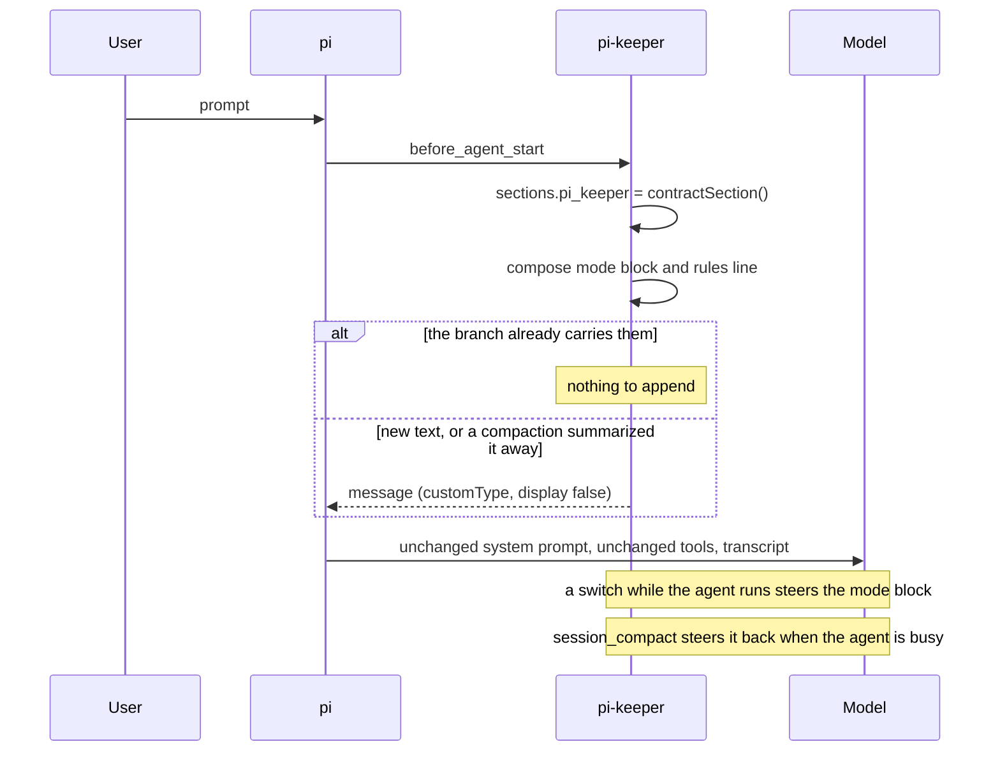

# pi-keeper: architecture

How the package is put together and where to change things. Start here for a
task; read [design.md](design.md) for *why* a rule exists and
[../README.md](../README.md) for what the user sees. Code wins over this file:
it names files and symbols, not line numbers, so it stays true longer.

## Highlights

1. **One gate.** Every tool call passes `pi.on("tool_call")` in
   `extensions/index.ts`; the decision comes from `evaluate` in `rules.ts`
   over the rule set of the current mode (`MODES` in `modes.ts`).
2. **Strictest wins.** deny > ask > allow across all matching rules; the
   mode's fallback applies only when nothing matches.
3. **Fail closed.** Unparseable or unresolvable input is not read-only and not
   covered by a rule (`utils.ts`).
4. **Approved means unchanged.** After a dialog approves a call its input is
   locked (`lockApprovedInput`); another extension changing it fails the call.
5. **Plan mode writes exactly one project file**, the session plan file;
   `exit_plan_mode` reads that file and is the only approval path.
6. **Everything the model reads from us is catalogued below**
   ([Model-facing text](#model-facing-text)). Change those strings there, in
   the code and in the pinned tests together.
7. **Data vs logic.** `modes.ts` is tables only; `utils.ts` analyses commands
   and paths; `rules.ts` decides; `index.ts` wires pi events, state and dialogs.

## Module map

| Layer | File | Role |
|---|---|---|
| Wiring | `extensions/index.ts` | Default export `keeperExtension(pi, {childMode})`: state, event hooks, `ask()` dialog flow, `exit_plan_mode` tool, `/mode` `/plan` `/permissions` `/keeper`, shortcuts, persistence, subagent bridge/relay glue |
| Wiring | `extensions/child-plan.ts`, `child-default.ts`, `child-auto.ts` | Entry shims for subagent children (`childMode` forced; `child-auto` picks auto or default by whether the child's asks can reach a user: a UI relay, or the parent's mailbox); not in the pi manifest |
| Data | `extensions/modes.ts` | `MODES` (default/auto/plan: tools, rules, fallback, badge, prompt), `GLOBAL_RULES`, `MODE_CYCLE`, `MODE_ANNOUNCEMENTS`, `PRIVILEGE_REASON`, every command/path table |
| Decision | `extensions/rules.ts` | `evaluate`, the `Matcher` union, `lockApprovedInput`, `commandOf`/`pathOf` |
| Analysis | `extensions/utils.ts` | Tokenizer, read-only classifier, dangerous/privileged/secret detection, outside-cwd checks, prefix derivation and pattern ladder, scratch dir |
| Persistence | `extensions/project-rules.ts` | `.pi/settings.local.json` parse/compile, trust hash store, atomic save |
| UI | `extensions/settings-panel.ts` | the `/keeper` panel: one tab per section (`flowSections` in `index.ts`), a `SettingsList` per section for the aligned label/value rows and the cycle-on-Enter keys, a one-line input for a free-text row, Tab/Shift+Tab for the tabs, the apply result in the footer |
| Persistence | `extensions/config.ts` | `<agent dir>/pi-keeper.json` (`readOnlyTools`, `subagentsFollowAuto`, `projectExactCommands`, `backgroundAutoFallback`, `backgroundAsks`, `backgroundAskTimeoutMs`, `backgroundAskPopup`, `projectCommandApprovals`, `projectReadApprovals`, `modeInstructions`, `commandColors`), `backgroundAsksEnabled` (setting + env kill switch), parse with defaults and warnings, merge-save for `/keeper` |
| Prompt | `extensions/child-lane.ts` | `childLaneLine` (the per-lane awareness text appended to every child prompt, computed from mode + relay + actual tools), `childLaneName` (shared with the deny messages), `parentLaneHint` (the one-sentence parent hint: agent roles, background-child behaviour, and the workflow-script form that survives a reply which already made a tool call) |
| UI | `extensions/dialog.ts`, `options.ts`, `title.ts`, `preview.ts`, `attention.ts` | Permission dialog, option lists, styled titles, diff/command preview, bell; the full-command body takes the `commandColors` slot, or pi's highlighter (`builtin-syntax`), or the renderer `pi-shell-highlight` publishes under `Symbol.for("pi.shell-highlight.v1")` via `shell-highlight-bridge.ts` (`shell-highlight`; unset, it is used when that package is loaded and `dim` otherwise, and an explicit `shell-highlight` without the package falls back to `dim`). `shell-highlight` also paints the one-line `bash: <command>` title (a segment carries its language) and a `bash`/`sh` fence in the plan view (`paintShellLines`, `plan-approval.ts`) |
| UI | `extensions/rules-view.ts` | The `/rules` view: `rulesRows` (pure), `renderRulesList`/`renderRuleDetail` (pure, narrow theme) and a small `ctx.ui.custom` component (Enter opens one rule, Esc back, Esc again closes); `rulesText` is the plain form for a session without a TUI |
| UI | `extensions/dialog-lock.ts` | `withDialogLock`/`isDialogLocked`: a FIFO lock so only one dialog is open (pi has one editor slot and does not queue); every user-facing dialog takes it |
| UI | `extensions/plan-approval.ts` | `PlanView` transcript row and the docked plan selector |
| Integration | `extensions/subagents-bridge.ts`, `ui-relay.ts` | pi-subagents registry, parent UI relay for foreground child asks; `relaylessChildMode` (the mode of a child with no UI relay) |
| Integration | `extensions/session-grants.ts`, `session-grant-store.ts` | The parent's session grants published to a per-session file, read by background children |
| Background asks | `extensions/ask-mailbox.ts` | The file mailbox schema and hardened I/O: request, reply and cancel files under `<agent dir>/pi-keeper/asks/<sha256(parent session)>/`, strict validation, claim-by-rename, caps, sweep |
| Background asks | `extensions/ask-server.ts` | Parent side: polls the mailbox, re-judges each request (`judge`), answers the settled ones, queues the rest for the dialog under the popup policy (`mayPopUp`), badge, TTL, drop of dead children, `stop()` denies what is pending |
| Background asks | `extensions/ask-heartbeat.ts` | `<askDir>/alive` (`{v, pid, at}`): the parent writes it while its server runs; the child's `heartbeatFresh` gates asking |
| Background asks | `extensions/remote-relay.ts` | Child side: `askParent` files the request and polls for the reply (fails closed), `parentListening`, `canAskParent`, `sanitizeLabel` |
| Background asks | `extensions/secure-file.ts` | Shared hardened I/O: `writeFileAtomic` (0600, O_EXCL|O_NOFOLLOW, rename), `ensureSecureDir` (0700, ours, symlink walk), `readJsonFile` (lstat, O_NOFOLLOW, owner, size cap), `isPidAlive` |
| Integration | `extensions/rtk-rewrite.ts` | Optional `rtk rewrite` of approved bash |
| Observability | `extensions/telemetry.ts` | `pi-keeper-permission` session entries (never sent to the model) |
| Prompts | `prompts/contract.md`, `plan-mode.md`, `auto-mode.md`, `default-mode.md`, `child-plan.md`, `child-default.md`, `child-auto.md` | `contract.md` is the constant system-prompt section; the mode prompts are the first part of the mode message; none load as commands (`pi.prompts: []`) |
| Prompt blocks | `extensions/prompt-blocks.ts` | Composes the constant section (with its `{{placement}}` paragraph), the mode message and a child's rules message, and decides what still needs sending (`nextDelivery`: the whole block on any change, a grant included); pure, unit-tested |
| Rulebook | `extensions/rulebook.ts` | Behaviour rules that fire on the model's finished answer: rule files (`description` + `condition` + body), discovery (user `<agent dir>/pi-keeper/rules`, project `.pi/rules` behind the trust gate), matching the last `RULE_SCAN_CAP` chars once per session, the correction text from `prompts/rule-warning.md`, and the fired records read back from the branch; free of pi types, unit-tested |
| Child thinking | `extensions/thinking.ts` | `THINKING_LEVELS` (pi's order), `childThinkingLevel`: the `/keeper` setting `subagent-thinking` (`follow` = the higher of the child's own level and the parent's, `role` = the child's own), `maxThinking`; pure, unit-tested |
| Scripts | `scripts/extract_flow.py`, `exclude_exit_plan_mode.py`, `scripts/charts/` (`lib.ts` reads the charts, `check.ts` renders them) | Rebuild a session's permission flow (`--stats`: aggregate per model); render the docs' Mermaid charts; pi-cc-extensions renderer opt-out |
| Tests | `tests/unit`, `tests/integration`, `tests/mocks/pi.ts` | See [Testing](#testing) |

Import direction (no cycles): `index` → everything; `rules` → `utils`,
`modes`, `project-rules`; `utils` → `modes`; `project-rules` → `utils`;
`rulebook` → `modes`, `project-rules`; `plan-approval` → `dialog`, `preview`,
`title`; `modes` imports only a type from `rules`; `ask-server` → `ask-mailbox`,
`ask-heartbeat`, `secure-file`, `subagents-bridge`; `remote-relay` →
`ask-mailbox`, `ask-heartbeat`, `session-grants`. `project-rules.ts`,
`rulebook.ts`, `utils.ts`, `rules.ts` and the background-ask modules (`ask-*`,
`remote-relay`, `secure-file`, `dialog-lock`) have no pi types, so they are
unit-testable without the harness; `index.ts` supplies `judge`, `ask` and the
UI callbacks.

## Life of a tool call

1. `tool_call` fires. `decide()` runs `evaluate(MODES[mode].permissions,
   GLOBAL_RULES, call, evalContext)`. The context carries session rules,
   project rules (re-read when the file signature changes, trust gate
   applied), workflow-command grants, MCP read-only hints, read grants, fetch hosts.
2. `allow` returns (a note may be attached for the "why it ran" badge).
   `deny` returns `{block, reason}` where `reason` comes from `denyReason()`;
   privilege escalation also terminates the turn.
3. `ask` joins `dialogQueue` (dialogs are serialized). The decision is
   re-evaluated after waiting; if the user already rejected something this
   run (`rejectedThisRun`) the call is auto-rejected without a dialog.
4. `ask()` builds the option list (`options.ts`), the preview, rings the
   attention bell and shows `permissionDialog` under `withDialogLock`. A
   foreground child asks through the UI relay; a background child files the
   call in the parent's mailbox (`askTheParent`, below); with neither, or with
   no UI, the ask is denied.
5. The answer dispatches: allow once, remember for session/project (pattern
   ladder), allow edits, switch to auto, grant a directory, reject, reject with
   feedback. Each branch logs a telemetry entry.
6. On approval of bash the optional rtk rewrite is applied, then the input is
   locked.

### Life of a background ask

```
background child                         <askDir>                       parent (ask-server, every 500 ms)
tool_call -> ask()
  canAskParent? (setting, snapshot,
   fresh heartbeat) else deny at once
  askParent: write requests/<id>.json -->
                                                                        takeRequests: rename -> .taken
                                                                        judge(request): own rules + grants,
                                                                          stricter(own clamp, claimed mode)
                                                                        allow / deny -> reply now
                                                                        ask -> queue; mayPopUp? (popup policy,
                                                                          dialog lock) else badge + /approvals
                                                                        dialog "Background subagent <name>:"
  poll replies/<id>.json (250 ms) <--  replies/<id>.json {nonce, decision} grants applied here, then reply
  allow -> the call runs
  deny/cancelled -> deny text with a reason clause
```

The child also stops waiting when `parentListening` turns false (deny
`parent-gone`, at once), at `backgroundAskTimeoutMs` (deny `timeout`) or when
its abort signal fires (`cancelled`); in the last two it files `cancels/<id>.json`
so the parent closes the dialog. The parent's `stop()` (session end, `/new`,
`/resume`, `background-asks` toggled off) denies everything pending with
`parent-session-ended` and removes the heartbeat. Telemetry: a dialog's answer
is logged where it is shown; what the server settled itself (`remote-auto-allow`,
`remote-auto-deny`, `remote-denied`, `remote-cancelled`, `parent-gone`) and a
clamped mode are logged by `logRemote`; the child logs `parent-ask`.

## Events, tools and commands

| Hook / registration | Purpose |
|---|---|
| `tool_call` | The gate above |
| `before_agent_start` | Sets the constant `pi_keeper` section (the contract), then appends the mode message (a child: the rules message) when it changed; with `modeInstructions: "prompt"` composes contract + mode + rules into the section instead; children get their prompt here; resets `rejectedThisRun`; re-reviews project rules |
| `session_compact` | Re-delivers a mode/rules message a compaction summarized away; steers it when the agent is busy; nothing in prompt placement |
| `input` | A real user message clears `rejectedThisRun` and starts a workflow-command grant |
| `turn_end` | The rulebook (parent only, `outcome` completed): matches the turn's assistant text, appends ONE hidden `pi-keeper-rule` correction and one `pi-keeper-rule-fired` card/record per rule fired, and asks for one continuation when the turn had no tool results (bounded by `RULES_PER_RUN_CAP`; a rule fires once per session, so it terminates) |
| `agent_end` | Clears the workflow-command grant; tells the ask server the run ended, so waiting background asks may open |
| `session_start` / `session_tree` | Restore mode and plan file from the branch, reset per-session flags, sync bridge/relay, (re)start the ask server (parent only) |
| `session_shutdown`, `mcp_servers_change` | Dispose registrations; stop the ask server (denying pending asks); drop cached MCP hints |
| Tool `exit_plan_mode` | Plan approval (`defaultActive: false`; declared in every mode so the tool list never changes, denied by rule outside plan mode) |
| Commands `/mode`, `/plan`, `/permissions`, `/rules`, `/keeper`, `/approvals` | Mode picker, plan file, rule management, the rulebook listing, settings (selector + `<setting> <value>`: on/off, a choice or a duration, persisted to the config file), open the waiting background asks (parent only) |
| Shortcuts Alt+M, Ctrl+Shift+M | Cycle default → auto → plan |
| Flag `--enable-builtin-tools` | Bring back pi's grep/find/ls |

## State

| State | Lives in | Lifetime / persistence |
|---|---|---|
| Mode, plan file path | closure; session entry `pi-keeper` | Persisted on change, restored per branch; `/new` starts in default |
| Plan file | `~/.pi/agent/plans/<project>-<stamp>.md` | One per session, never deleted |
| Session rules, outside-read flag and dirs, fetch hosts | module level | Reset when a new session starts (`/new`, `/resume`, fork; parent `session_start` only, the child guard is defensive). A child has its own module state (pi evaluates each extension path with its own module cache) and sees the parent's grants only through `sharedRules()`: the UI relay, or the published snapshot for a background child. A background child that outlives a parent `/new` or `/resume` loses them, since the old snapshot is withdrawn; its asks are then denied (`parent-session-ended`) because the mailbox is closed |
| Exact commands approved for the session (`rememberedVerbatim`) | module level | Reset when a new session starts; default mode only; not shared with children |
| `readOnlyTools` | closure, from `<agent dir>/pi-keeper.json` | Re-read on `session_start` |
| Allow-all-edits flag | closure | Reset when a new session starts (`/new`, `/resume`, fork) |
| Workflow-command grant | closure | One run |
| Project rules | `<project>/.pi/settings.local.json` | Persistent; allow rules need the trust hash |
| Rulebook rules fired this session | `pi-keeper-rule-fired` session entries, read back on `session_start`/`session_tree` (`firedFromBranch`) | In the session file; a resume or a fork cannot re-fire one |
| Rulebook rules (the parsed rules) | none: `syncRulebook` re-reads both directories per turn and per prompt (`countWork("rulebookSync")`) | Not cached on purpose — a stale rule is a wrong correction, and the directories are tiny |
| Project rule files the user loaded or ignored this session | closure (`rulebookReviewKey`, `rulebookIgnoredKey`, `rulebookWarnedKey`) | Reset at `session_start` |
| Trust store | `<agent dir>/pi-keeper/trusted-rules.json` | Persistent |
| Scratch dir | `<tmp>/pi-keeper-XXXXXX` (0700) | New per session, never deleted |
| Session-grant snapshot | `<agent dir>/pi-keeper/session-grants/<sha256(session id)>.json` | Rewritten on every grant change; withdrawn at shutdown or session switch; stale files of dead pids swept at start |
| Ask mailbox | `<agent dir>/pi-keeper/asks/<sha256(session id)>/{requests,replies,cancels}/<uuid>.json` (dirs 0700, files 0600) | A request lives until answered, cancelled, dropped (child gone), or older than `askTtlMs(backgroundAskTimeoutMs)` (timeout + 1 min, at least `ASK_TTL_MS` = 15 min; then swept after a grace); the files are removed by the child in `finally` |
| Ask heartbeat | `<askDir>/alive` | Rewritten every 10 s while the server runs; stale after 15 s; removed at `stop()` |
| Ask server queue, taken map, badge | closure in `ask-server.ts` / `index.ts` (parent only) | Rebuilt at `session_start`; at most `MAX_QUEUE` (100) requests held; the taken map is in memory, so a restarted parent restarts the TTL clock |
| Decision log | session entries `pi-keeper-permission` | In the session file |

## Workflows

| Workflow | Files | Pinned by |
|---|---|---|
| Mode switching | `index.ts` (`switchMode`, `applyMode`), `modes.ts`, `dialog.ts` | `flows.test.ts` |
| Prompt prefix and mode-message delivery | `prompt-blocks.ts` (`contractSection`, `nextDelivery`), `index.ts` (`before_agent_start`, `applyMode`, `session_compact`), `modes.ts` (`CONTRACT`, `MODE_ANNOUNCEMENTS`) | `prefix.test.ts`, `prompt-blocks.test.ts`, `modes.test.ts` |
| Permission dialogs and remembered commands | `index.ts` (`ask`, `patternFlow`), `options.ts`, `utils.ts` (ladder), `dialog.ts` | `dialogs.test.ts`, `utils.test.ts` |
| Plan mode and approval | `index.ts` (`exit_plan_mode`), `plan-approval.ts`, `prompts/plan-mode.md` | `flows.test.ts`, `intent.test.ts`, `plan-approval.test.ts` |
| Project rules and trust gate | `project-rules.ts`, `index.ts` (`syncProject`, `reviewProject`) | `project-rules.test.ts` |
| Rulebook (a rule fires, warns once, never blocks) | `rulebook.ts`, `rules-view.ts`, `prompts/rule-warning.md`, `index.ts` (`syncRulebook`, `reviewRules`, the `turn_end` handler, the entry renderer, `/rules`), `project-rules.ts` (`trustedHash`); debugging and follow-up in [rulebook.md](rulebook.md) | `rulebook.test.ts` (unit), `rules-view.test.ts`, `rulebook.test.ts` (integration), `intent.test.ts`, `prompt-weight.test.ts` |
| Reads outside the project | `rules.ts` matchers, `utils.ts` (`readGrantDir`) | `read-grants.test.ts` |
| Fetch grants (curl/wget GETs to granted hosts) | `utils.ts` (`fetchHost`, `fetchGrantHosts`), `project-rules.ts` (`Fetch(<host>)`), `options.ts` | `fetch-grants.test.ts` (unit and integration) |
| Workflow-command grants | `index.ts` (`startWorkflowGrant`) over prompt templates and `/skill:name` skills (`tests/fixtures/commit-template.md`) | `flows.test.ts` |
| Subagent relay | `subagents-bridge.ts`, `ui-relay.ts`, `child-*.ts` | `child-relay.test.ts`, `subagents.test.ts` |
| Background asks | `remote-relay.ts`, `ask-mailbox.ts`, `ask-server.ts`, `ask-heartbeat.ts`, `secure-file.ts`, `dialog-lock.ts`, `index.ts` (`askTheParent`, `askRemote`, `judgeRemote`, `startAsks`, `/approvals`) | `ask-mailbox.test.ts`, `ask-server.test.ts`, `ask-heartbeat.test.ts`, `remote-relay.test.ts`, `dialog-lock.test.ts`, `background-asks.test.ts` |
| rtk rewrite and canonical form | `rtk-rewrite.ts`, `utils.ts` (`canonicalize`) | `rtk-rewrite.test.ts`, `utils.test.ts` |
| Telemetry | `telemetry.ts`, `scripts/extract_flow.py` | `telemetry.test.ts` |
| Cost measurement | `perf.ts` (counting seam, off by default), `scripts/bench.ts`, `tests/unit/perf.test.ts` | `perf.test.ts` |

> **The mode message, one run.** The system prompt and the tool list never change; what
> varies is appended to the conversation when it changes, so a run either sends nothing
> (`the branch already has this text`) or one hidden message. A rulebook fire adds a
> second kind of hidden message (`pi-keeper-rule`) on the turn it fires — never
> part of the prompt, never part of the mode block.



## Model-facing text

Small local models (7-14B) follow short, positive, single-source directions and
lose the thread when a rule is repeated with different wording or contradicted
at the point of use. These are our own rules; other harnesses (Claude Code,
OpenCode, ...) are comparison points, not templates. Practices we share with
them: a short imperative plan reminder, an approval tool that reads the plan
from a file and says when *not* to use it, an approval result that is one
sentence followed by the plan, and a rejection that says "stop and wait"
(adding the user's words when given).

### Catalogue

| Text | Where | Shown | Job |
|---|---|---|---|
| Contract | `prompts/contract.md` via `contractSection()` | Constant `pi_keeper` section of the system prompt, every mode, every run | The permission layer, where the mode lives and "the newest mode message wins" (`{{placement}}`), one line naming the three modes, the gates that hold in every mode, rejection and privilege handling, the scratch convention |
| Mode prompt | `prompts/<mode>-mode.md`, in the `pi-keeper-mode` message | Conversation, on a switch (or when the prompt file was missing) | Rules and next steps of the mode |
| Plan file line | `planFileLine()` in the mode message (plan only) | Right after the mode prompt | The one statement of the plan path and the write rule, phrased so it does not change when the file appears |
| Search hint | `RTK_SEARCH_HINT` / `BUILTIN_SEARCH_HINT` via `searchHint()`, part of the contract (and of a child's prompt) | Every mode | With rtk installed: use `rtk grep/find/ls`; a curl GET asks until its host is allowed; `rtk grep` drops indentation, so exact edit text comes from `read`. Without rtk: the built-in search tools, else plain `grep`/`find`/`ls` in bash. Chosen once at load (`RTK_INSTALLED`), never per mode |
| Todo path | `TODO_PATH`, part of the contract (and of a child's prompt) | Every mode | Write the steps with `todo`, one in progress at a time; a subagent builds its own list |
| Rules line | `rulesLine()`, last part of the mode message (a child: the `pi-keeper-rules` message) | Conversation, with the whole block when the user's rules change | The user's own rules and this session's grants |
| Closing instruction | `MODE_ANNOUNCEMENTS`, last line of the mode message | On a mode switch | Names the next step ("Continue the task.", "Call `exit_plan_mode`…") |
| Re-entry / left-plan note | `PLAN_REENTRY_NOTE` and the left-plan sentence, in the mode message | Second `/plan` with a plan on disk; leaving plan mode by hand | Read, then update or overwrite; where the plan file is |
| `exit_plan_mode` description and `commands` parameter | `index.ts` | In the tool list | When to use it, that it reads the file |
| Approval / feedback / reject / abort / superseded results | `index.ts` (`exit_plan_mode`) | Tool result | Tell the model exactly what happens next. A "keep planning" note names both moves — an edit for a change request, a text answer for a question such as "where is the plan?" — and always asks for the tool again, because the review stays open until the user decides |
| Deny reasons | `denyReason`, `PRIVILEGE_REASON`, `rejectionReason` | Tool result of a blocked call | Why, and the alternative |
| Child prompts | `prompts/child-*.md` | Subagent system prompt | Permission behaviour of a child |
| Rule warning | `prompts/rule-warning.md` via `RULE_WARNING`, filled in by `correctionText()` (`rulebook.ts`) | A hidden `pi-keeper-rule` message, only when a rule fires, once per rule per session | What happened (a rule matched your last message; a warning, not a block), what to do (fix a real violation in your next message, otherwise continue), then the rule's name, description and body |
| Parent lane hint | `parentLaneHint` (`child-lane.ts`), delivered in the parent's mode message only while `subagent` is active | Parent conversation | Agent roles, what a background child can do, and `options.script` for a scripted fan-out (a fenced `js workflow` block is dropped once the reply has made a tool call) |
| Skills catalog | written by pi-subagents from Pi's discovery (we do not write it) and by pi's own `formatSkillsForPrompt` for the session | System prompt, parent and child | Which skills exist and the exact file to read; we only *read* it, to learn which skill files are readable (`skillDirsFromPrompt`) |

### Checklist (apply when adding or editing any of the above)

1. **One home per instruction.** Say it where the model acts on it (tool
   description or result), not in three places with different words.
2. **Say what to do next.** Every deny, rejection and result ends with a verb:
   continue, edit file X then call tool Y, stop and wait.
3. **The path and the tool together.** "Write the plan with `write`/`edit`" and
   the path sit next to each other, up front.
4. **Positive over negative.** At most a few hard NEVERs; the rest is
   phrased as what to do.
5. **No contradiction with the harness.** If a rejection ends the turn
   (`terminate`), the prompt must say "stop and wait", not "keep going".
6. **Same words for the same event** (approved / not approved / mode
   changed). The phrases in `intent.test.ts` are fixed.
7. **Short.** `tests/unit/modes.test.ts` caps the mode prompts, the closing
   instructions and `prompts/contract.md`; do not grow them without removing
   something.
8. **Truthful about the mode.** A child runs the lane its lane line names
   (an auto parent's child runs default rules unless `subagentsFollowAuto` is on),
   and the deny text says which lane and, for a background ask, why it got no
   answer.

## How to change X

| Change | Edit | Then |
|---|---|---|
| A read-only command | `READ_ONLY_BASH_COMMANDS` (or per-tool table) in `modes.ts`; flag rules in `utils.ts` `segmentBlocker` | `utils.test.ts` |
| A mode's text or the contract | `prompts/<mode>-mode.md` / `prompts/contract.md`, composed in `prompt-blocks.ts` | `prompt-blocks.test.ts`, `modes.test.ts` (length caps), `mode-prompts.test.ts` (every gate is named); never put mode-specific text in the contract — it is the constant prefix |
| Mode rules | `MODES` in `modes.ts` (new matcher: `Matcher` + `matches` in `rules.ts`) | `rules.test.ts`, `intent.test.ts`; the flowcharts in [design.md](design.md#behaviour-at-a-glance), which `mode-charts.test.ts` ties to `MODES` and `GLOBAL_RULES` by rule name and layer (re-read the arrows by hand); `npm run check:charts` (in pi-keeper) checks them with Mermaid's own parser |
| A dialog option | `options.ts`, handler in `index.ts` `ask()` | `dialogs.test.ts` catalogue, README "The dialogs" |
| Which other-package tools count as read-only | `readOnlyTools` (default list in `config.ts`) | `config.test.ts`, `session-fixes.test.ts` |
| A `/keeper` setting | the `flowSettings()` table in `index.ts` (parse/save in `config.ts`) | `config.test.ts`, `subagents.test.ts` |
| What a child may write | matcher `subagentArtifact` (`rules.ts`, `isSubagentArtifactPath` in `utils.ts`) | `rules.test.ts`, `session-fixes.test.ts` |
| Plan approval wording | `index.ts` `exit_plan_mode`, `prompts/plan-mode.md` | `flows.test.ts`, `modes.test.ts`, [checklist](#checklist-apply-when-adding-or-editing-any-of-the-above) |
| Plan row rendering | `plan-approval.ts` | `plan-approval.test.ts` |
| Child behaviour | `subagents-bridge.ts`, `child-*.md` | `child-relay.test.ts`, `subagents.test.ts` |
| A child's role, skills or thinking | agent files are pi-subagents' own (`~/.pi/agent/npm/node_modules/pi-subagents/agents/*.md`); what we add is settings: `subagents.agentOverrides.<name>` in `~/.pi/agent/settings.json` (here `inheritSkills: true` for `scout`/`worker`/`reviewer`) plus `/keeper subagent-thinking` | `thinking.test.ts`, `subagent-thinking.test.ts`; check `agentOverrides` first when a role ignores its agent file — an override wins over every definition, package and builtin alike |
| What a read outside the cwd may touch | `PathContext.skillDirs` and `isOutsideCwdRead` in `utils.ts`, `skillDirsFromPrompt` (parses the prompt's `<available_skills>`), `runSystemPrompt` in `index.ts` (captured in `before_agent_start`) | `skill-reads.test.ts`, `read-grants.test.ts` (unit), `read-grants.test.ts` (integration: a skill read without a dialog) |
| Whether an auto parent gets auto children | `subagentsFollowAuto` (`config.ts`), `childModeFor` (`subagents-bridge.ts`), the relay-or-mailbox check in `child-auto.ts` | `subagents-bridge.test.ts`, `subagents.test.ts`, `child-relay.test.ts`, `intent.test.ts` |
| How a background child asks its parent's user | `remote-relay.ts` (`askParent`, `canAskParent`), the `ask()` branch in `index.ts`, `ask-mailbox.ts` / `ask-server.ts`, `ask-heartbeat.ts` (the parent's `<askDir>/alive` note: a child asks only while it is fresh) | `remote-relay.test.ts`, `ask-heartbeat.test.ts`, `background-asks.test.ts` |
| Popup policy, badge and `/approvals` | `mayPopUp`, `badgeText`, `openNow` (`ask-server.ts`), `backgroundAskPopup` (`config.ts`), the command in `index.ts` | `ask-server.test.ts`, `background-asks.test.ts` |
| Whether a child with no way to ask runs auto instead of default | `backgroundAsks` / `backgroundAutoFallback` (`config.ts`), `relaylessChildMode` (`subagents-bridge.ts`, shared by `child-default.ts`, `child-auto.ts` and the parent's `backgroundChildMode`; read at child launch; the bridge registration is unaffected) | `config.test.ts`, `child-relay.test.ts`, `subagents.test.ts` |
| What a child is told it may do, and what a denial says | `childLaneLine`/`childLaneName`/`parentLaneHint` (`child-lane.ts`), the child branch of `before_agent_start` and `relaylessChildDeny`/`denyReason` (`index.ts`) | `child-lane.test.ts`, `child-relay.test.ts`, `subagents.test.ts` |
| A child's thinking level | `subagentThinking` (`config.ts`), `childThinkingLevel`/`maxThinking` (`thinking.ts`), `applyChildThinking` + `currentThinkingLevel` (`index.ts`), the level in `UiRelaySessionRules.thinking` (`ui-relay.ts`, published by `session-grants.ts`) | `thinking.test.ts`, `config.test.ts`, `subagent-thinking.test.ts` (integration) |
| Whether exact-command dialogs offer a project rule | `projectExactCommands` (`config.ts`), `exactRuleTokens`/`isRememberableExact` (`utils.ts`), the option gate in `index.ts` `ask()`, the exact-entry check in `parseRule` (`project-rules.ts`) | `utils.test.ts`, `project-rules.test.ts`, `dialogs.test.ts`, `intent.test.ts` |
| A rulebook rule's fields (`description`, `condition`) | `splitFrontmatter` / `parseRuleFile` (`rulebook.ts`), the text in `prompts/rule-warning.md` | `rulebook.test.ts`; a new field is one key in the splitter, and the format is documented in README "The rulebook" |
| The token budget of injected text | `prompt-blocks.ts` (`estimateTokens`), `scripts/prompt-weight.ts` (`npm run prompt-weight`), the caps in `tests/unit/prompt-weight.test.ts` | run the script, then pin the new numbers and the file to trim |
| Diagnose a rulebook rule (never fires, fires wrongly, correction cut) | [rulebook.md](rulebook.md) — the debugging tables, the session entries to grep, and the follow-up order | `npm run rulebook-check`, `npm run rulebook-fires -- --evidence`, `/rules` |
| Diagnose a surprising ask | `python3 scripts/extract_flow.py --latest` | |
| Measure prompt fatigue and plan outcomes over many sessions | `python3 scripts/extract_flow.py --stats ~/.pi/agent/sessions` | compare with the baseline in [challenges.md](challenges.md) |

## Testing

`npm test` (`node --test`, TypeScript run directly), `npm run typecheck`. Unit
tests are one file per module. `tests/mocks/pi.ts` is a fake `ExtensionAPI`
that fires events and answers dialogs from a script; integration suites run
user stories (`flows.test.ts`), the dialog catalogue (`dialogs.test.ts`),
child relay and subagents. `intent.test.ts` pins user promises in the user's
words: if it fails, the intent is changing and that is a design decision, not a
test edit. `mode-charts.test.ts` reads the Mermaid flowcharts in design.md
and fails when a rule in `modes.ts` is missing from, or stale in, the chart of
its mode and layer. The peer packages (`@earendil-works/*`, `typebox`) come from
the workspace `npm ci`.
