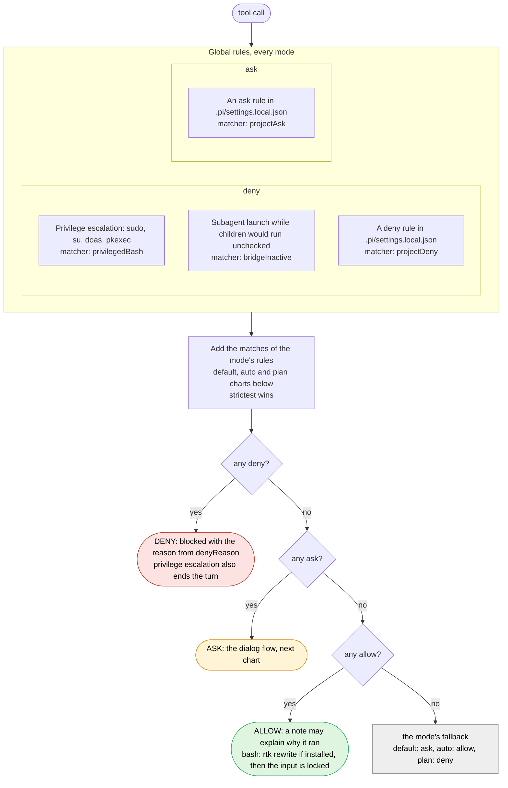
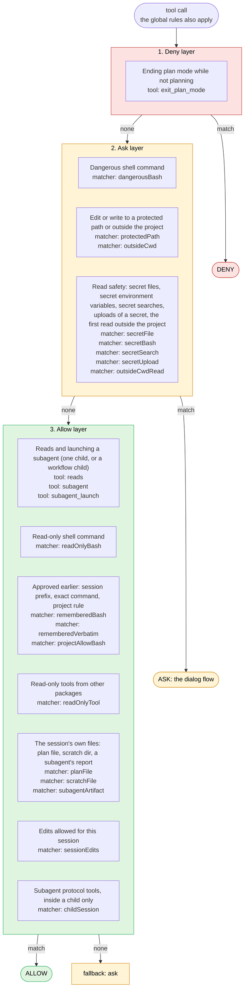
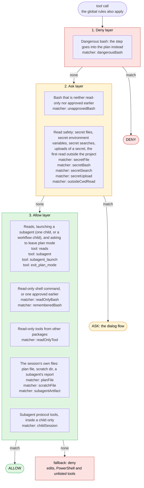

# pi-keeper: design

Why the permission model and plan flow look the way they do. Reading order:
[guide.md](guide.md) (what the user sees; [../README.md](../README.md) is the short version) → [architecture.md](architecture.md)
(modules, flows, state, model-facing text, how to change things) → this file
(the reasoning and the threat model). This file does not repeat command lists,
flag tables or dialog labels: those live in code and tests, and each section
says where. When a list and this text disagree, the code wins.

**Non-goals:** containing a hostile model (use a container or VM), judging
whether an action matches the request (there is no classifier), and managing
credentials.

## 1. Principles

- **Accident guard, not a sandbox.** The package stops a well-meaning model
  from doing something you didn't intend. It does not contain a hostile one:
  it can't see through `make deploy`, scripts or aliases, and in auto mode the
  model can edit the project rules file with a command. Use a container or VM
  when that matters. Other agent harnesses say the same about rule-based asks.
- **Fail closed.** Anything that can't be parsed or resolved confidently is
  not read-only, not covered by a rule, or denied. The one deliberate
  exception is auto mode's write-outside-the-project check, which lets an
  unresolvable target (`tee $OUT`) run, because auto is an accident guard
  and over-asking defeats it; destructive commands (`rm $X`) still fail
  closed there because the damage can't be undone.
- **Strictest wins.** Several things can apply to one call; the harshest
  decision stands, so adding an allow can never loosen a safety check.
- **Ask costs less than a mistake, but prompts are a budget.** Common choices
  are one Enter away, rare ones sit behind *More…*, and remembered rules turn
  repeated asks into silence, within limits that keep them sound.
- **Directions to the model are short, positive and name the next step.**
  Everything we send the model (mode prompts, tool descriptions and results,
  deny reasons) is read by models as small as 7B. Each instruction lives in one
  place, the place where the model acts on it, and never contradicts what the
  harness does (a rejection that ends the turn is described as "stop and
  wait"). The catalogue and checklist are in
  [architecture.md](architecture.md#model-facing-text).

## 2. Rule evaluation

Each mode (`MODES` in `extensions/modes.ts`) is a **fallback action** plus a
list of **rules**. Every rule that matches a tool call contributes its
action; `evaluate` in `extensions/rules.ts` takes the strictest:
**deny > ask > allow**, the usual precedence for allow/ask/deny rule sets. If nothing matches, the fallback
applies (default: ask, auto: allow, plan: deny). Consequences:

- An allow rule never overrides a dangerous-command ask, a secret ask or the
  privilege deny. `allow Bash(git push *)` still asks.
- Every tool call goes through the rules, including tools from other
  packages, MCP, PowerShell and codemode tools. Hiding a tool is not treated
  as enforcement.
- Matchers are predicates over the call (`outsideCwdRead`,
  `outsideCwdDestructive`, `secretSearch`, ...); the table in `MODES` shows
  which tool kinds and modes each one asks or denies in.

### Mode rule sets, conceptually

- **default:** reads and read-only bash are free; everything else asks;
  rules (session, project, workflow command) can cover bash.
- **auto:** allow by default plus a fixed ask list (section 9). No rule is
  needed to run things.
- **plan:** deny by default plus an allowlist: reads, read-only bash, the plan
  file and scratch dir, read-only MCP tools. Non-read-only bash asks (planning
  sometimes needs a test run); dangerous bash is denied, not asked, because it
  is never context-gathering and a dialog would invite the model to run it.

The charts under "Behaviour at a glance" draw all three.

### Behaviour at a glance

The charts show what the rule tables in `modes.ts` do. They are drawn as
**layers**, not as an if-chain: `evaluate` takes the strictest matching rule
(deny, then ask, then allow), so an ask below never has to "wait for" an allow
above it, and the order of the rules is not behaviour. Read each mode chart as
*any deny rule matches → deny; else any ask rule matches → ask; else any allow
rule matches → allow; else the fallback*. The global rules (first chart) take
part in every mode, so a global deny or ask beats a mode's allow.

Every rule group node names its rules as `matcher: <name>` or `tool: <name>`
(`tool: reads` stands for the read-only built-ins in `READ_TOOLS`). These tags
are what `tests/unit/mode-charts.test.ts` compares with `MODES` and
`GLOBAL_RULES`, layer by layer, so a rule added, moved or removed in
`modes.ts` fails the test until the chart is updated. The test checks names and
layers, not arrows: re-read the edges when you change one.

**Evaluation core.**

**What an ask does.** Option labels are not repeated here: they live in
`options.ts` and `tests/integration/dialogs.test.ts`.

**default** (fallback: ask): reads and read-only bash are free, everything else
asks, and rules you approved cover bash.

**auto** (fallback: allow): nearly everything runs; a fixed list asks.

**plan** (fallback: deny): an allowlist. Edits, PowerShell and tools nobody
listed are denied by the fallback; a command that is not read-only asks,
because planning sometimes needs a test run.

### Read-only MCP tools

A tool runs without a dialog in default and plan when its annotations say
`readOnlyHint: true` and `destructiveHint` is not `true` (pi reports them via
`pi.getAllTools()`; hints are cached per tool name and refreshed when MCP
servers change). A tool without annotations is not read-only. The matcher
(`NEVER_READ_ONLY_TOOLS` in `rules.ts`) excludes `bash`, `powershell`, `edit`,
`write` and `exit_plan_mode` regardless of claims. The trust is explicit: the
hints are the tool author's claim and aren't verified, so a server that
mislabels a write tool gets it run unasked. Any ask or deny rule still wins.
In plan mode these tools stay active because every mode declares the same
tools, and tools this package doesn't manage (`MANAGED_TOOLS`) are never swapped.

### Read-only tools from other packages

Tools from other packages carry no annotations, so `readOnlyTool` also
matches the names in `readOnlyTools` of `<agent dir>/pi-keeper.json`
(`extensions/config.ts`; defaults `web_search`, `fetch_content`,
`get_search_content`, `source_check`, `code_overview`, `lsp_diagnostics`). `mcp` (it runs any
MCP sub-tool, destructive ones included) and `subagent` can't be listed: the
name hides what runs, so config.ts rejects them with a warning and
`NEVER_LISTED_TOOLS` in `rules.ts` ignores them anyway. Plan mode used to deny these and tell the model to "add it to the
plan", which small models read as a bug, and default mode asked for every
`lsp_diagnostics` after an edit. The file is global only (a project file could
let a cloned repo grant itself tools), names are exact and `NEVER_READ_ONLY_TOOLS`
still wins. A tool nobody listed is denied in plan with wording that says it
is unavailable, not that it belongs in the plan.

## 3. Read safety

Secret files ask in every mode, even where a rule or auto mode would allow the call, because approving a read once does not undo the exfiltration. Recursive searches over a tree that holds a secret, and uploads of a secret file, ask even when a rule covers the command. A secret file that git tracks is repository content and does not ask in searches. Outside-the-project reads can be granted per directory, never for `/` or a home ancestor, since one answer there would cover nearly everything. Code: `extensions/utils.ts` (`isSecretFile`, `readGrantDir`); tests `tests/unit/read-grants.test.ts`.

## 4. Trust boundaries and threat model

Who is trusted, and what each input can do:

- **You** (dialogs, `/permissions`, your hand edits): full authority.
- **The model**: acts within the rules; it can edit files and run commands as
  allowed, including (in auto mode) the project rules file. Its tool input is
  never trusted to be what it looks like (heredocs, wrappers, `$(...)`,
  `xargs`, variable-held `sudo`).
- **A cloned repository**: may ship `.pi/settings.local.json`, prompt
  templates and `.pi` content. It must not be able to pre-approve commands.
- **Another extension**: may rewrite tool input after our decision.
- **A subagent child process**: runs the same code but its registry and UI
  messages are treated as input to be validated by the parent.

### Project rules and the trust gate

pi's own project trust can't protect `.pi/settings.local.json`: projects with
no risky resources are auto-trusted, so a cloned repo could carry `allow`
rules that run silently. Hence the gate (`extensions/project-rules.ts`,
`loadProjectRules`, `recordTrust`, `fileSignature`):

- `<agent dir>/pi-keeper/trusted-rules.json` maps the file's absolute
  path to the sha256 of its content, recorded when this package writes the
  file and when you approve a review. The same store holds the project's
  rulebook files (below): one path-to-hash map for every file that can change
  what the model is told or allowed to do.
- `deny` and `ask` rules load regardless: they only tighten, so a malicious
  file can't gain anything from them. A file that exists but cannot be read or
  is not valid JSON fails closed: the `projectAsk` matcher makes every shell
  command ask, in every mode, until the file is fixed, so a broken file never
  silently drops your rules.
- `allow` rules load only when the hash matches; otherwise a review dialog
  lists them (*Load them* / *Ignore for this session*), checked at session
  start and before every prompt. Without a UI they are ignored.
- The file is re-checked on every decision, so a mid-run change (by the model
  or anything else) leaves new allow rules inactive until reviewed.
- Our own writes record the new hash only if the content they replace was
  already trusted. Otherwise saving one rule would bless every unreviewed
  rule next to it; instead those stay under review and the new rule applies
  for the session only.
- Writes are atomic (temp file + rename), merge into the existing JSON, and
  never overwrite a file that isn't valid JSON. The file path is added to
  `.git/info/exclude` (worktrees and submodules resolved to the common git
  dir; `.gitignore` untouched) so personal permissions don't leak into
  commits.
- Known limit: in auto mode the model can *remove* `deny`/`ask` rules by
  editing the file with a command; that loosening needs no review. Added
  `allow` rules do.

Project `allow` rules are held to the same limits as "Yes, and always allow"
(no interpreters, runners, removals, privilege commands) so a hand-edited rule
can't grant what the dialog would never offer. `ask` rules also match inside
`sh -c`, `eval`, `$(...)` and `rtk proxy`, and skip flags between tokens
(`git -C x push` matches `git push *`), because a deny/ask that a wrapper
bypasses is worthless.

### The rulebook: project text that instructs the model

A project rule file (`.pi/rules/*.md`) is the same threat as a project `allow` rule, aimed at the model, so it gets the same review gate: an unreviewed file is not even parsed into a rule. Code: `extensions/rulebook.ts`.

### Approved means unchanged; the rtk exception

After you approve a bash, PowerShell or file-tool call, its input is locked: a later rewrite by another extension makes the call fail rather than run something you did not see. The one trusted exception is this package's own `rtk rewrite`, because rtk is a semantics-preserving optimizer (`extensions/rtk-rewrite.ts`).

### Subagent relay trust model

Children follow the parent's mode but never exceed it, and never switch modes themselves. Auto is granted only where the child's asks can reach a user (the parent's UI relay, or the mailbox for a background child; `child-auto.ts`): auto means "a trusted task someone is watching", and a child whose asks would be silently denied must not run with that little oversight. A child with no way to ask runs in default unless `background-auto-fallback` is on, because a default-mode child would deny every write and be useless; auto's fixed ask list still fails closed. Background children use the mailbox described in [Background asks](#background-asks).

The relay is trusted only because it is same-process code: the `Symbol.for` registries exist for foreground children in the parent process. A background child is a separate process and cannot reach them, so its input is untrusted. Everything fails closed: no relay or mailbox, a parent without a UI, a malformed registry or a failing relay denies the ask with a reason the agent can report, and the `subagent` tool is denied in every mode when registration failed.

Answers are shared both ways (session rules, edit flag, outside-read flag, granted directories, fetch hosts) because the user approved them for the session, not for one process. The parent re-validates anything a child sends back, keeps denying dangerous commands and privilege escalation in plan children, and never offers "switch to auto mode" to a child.

Two tool names mean "launch": `subagent` (one child) and `subagent_launch` (one per workflow child, never declared to the model). Both are in `LAUNCH_TOOLS`. Knowing only the first denied every workflow child in plan mode, where the allowlist is deny-by-default. The nested commands and writes inside a `subagent_launch` input are judged as bash and write calls under the same mode, and the strictest answer stands; a command's `env` and a `cwd` outside the project raise the answer to ask in every mode (`launchNestedHazards`).

Known gap: a child's report file under `subagent-artifacts/outputs/<id>/` may be written in every mode, but nothing checks that the directory is the child's own, since the artifact id is not its run id. One child can overwrite another's report.

### Background asks

A background child is a detached process with no UI. Denying what it cannot decide makes it useless, and auto mode makes it unsupervised. Neither answers the real question, which is what the user says about this call. So the child files the raw tool call and waits, and the parent's user answers in the dialog they already know. Code: `extensions/ask-mailbox.ts`, `ask-server.ts`, `remote-relay.ts`; tests `tests/integration/background-asks.test.ts`.

**The child asks, the parent decides.** A request is untrusted: the child's model may be prompt-injected, and a file in a shared directory is only as honest as whoever can write it. So the parent believes nothing in a request beyond the tool call, its working directory, a display label and a pid. It re-judges the call with its own rules and grants, answers without a dialog when those settle it, and only an `ask` reaches the user. The reply is `allow`, `deny` or `cancelled`, never a grant: if the user picks a remembering option, the parent applies it and the child sees it through the session-grant snapshot. The mode is the stricter of the parent's assignment and the mode the request claims, so a claim of auto under a default parent is clamped and logged.

**Why a file mailbox.** The channel must work between two unrelated processes that share only a filesystem and a session id. A socket needs an address, a lifecycle and authentication that peer credentials only partly give. pi's RPC channel connects a process to the client hosting it, and a runner is not one of those. `contact_supervisor` carries words to the parent model, not to the user, so its answer would come from the agent. A file under the agent dir reuses the one trust boundary already there and fails by being absent.

**Hardening.** Every read is `lstat` plus `O_NOFOLLOW`, must be a regular file owned by us, and is size-capped and strictly validated; writes go to a random tmp name and are renamed. Each directory on the path is checked for symlinks. Requests are claimed by rename, so exactly one taker wins. Each request carries a nonce the parent echoes, so a reply pre-created blind, or left from an earlier ask, does not match. Caps and a TTL bound a flood or a dead child. The mailbox guards against accidents and blind writers, not against a same-user process that can already write the agent dir.

**Fast deny and popup.** A child whose parent is not listening (no UI, asks off, stopped) would sit out its whole timeout, so the parent keeps a heartbeat file fresh and the child denies at once when it goes stale. One dialog is open at a time, because pi has one editor slot. `always` opens a dialog as soon as none is open; `idle` waits for an idle point, and `ctx.isIdle()` is false for the whole of any tool call, so an orchestrating parent that waits inside `subagent` calls should use `always`, or its children time out unseen.

Known limits: a reply is seen after up to about 0.5 s (both sides poll); a parent blocked for over 15 s looks gone to its children; a grandchild cannot ask and is denied.

## 5. Read-only classification

A mistake here is a silent action, so the classifier is an allowlist that fails closed: every segment of a compound command must pass, and an unknown flag or an unparsed script is not read-only. Allowing a command means allowing a shape of it (`sort` yes, `sort -o` no), and redirects to files, heredocs and substitution are rejected wholesale. `xargs` never makes an argument-sensitive tool read-only, because the words it appends are not the ones checked. Code: `isReadOnlyCommand` in `extensions/utils.ts`, tables in `extensions/modes.ts`; cases in `tests/unit/utils.test.ts`.

## 6. Dangerous commands and denied privilege escalation

The category list is `DANGEROUS_COMMANDS` in `extensions/modes.ts`, detected by `isDangerousCommand` in `extensions/utils.ts`. Dangerous commands ask in default and auto but are never remembered: a "don't ask again" on `git push` would turn a one-time decision into a standing one. They are denied in plan, because a plan is research and a dangerous step is never context-gathering. Privilege escalation is denied in every mode, auto included, because the model cannot type a password; you run it yourself. Protected paths (`PROTECTED_DIRS`, `PROTECTED_FILES` in `modes.ts`) ask in auto and default, since editing shell rc files or `.git/` changes how later commands behave.

## 7. Remembered commands

A stored prefix names a command, not a flag set, and the question is when it may silently cover a later command. Prefix matching on flags is unsound (`tsc --noEmit *` would cover `--outDir x`), so only the exact choice names flags. Interpreters, runners and removals are never remembered as prefixes, since a prefix over `python` or `rm` grants arbitrary code; an exact rule can name one, token for token. Project rules are default-mode only, because planning should not inherit standing write permissions. Code: `patternLadder` and `isCoveredByPrefixes` in `extensions/utils.ts`; tests `tests/unit/utils.test.ts`.

## 8. Scratch dir

Plan mode can write only the plan file, which leaves no room for notes or repros, so each session gets a scratch dir (`createScratchDir` and `isInsideScratch` in `extensions/utils.ts`). Writes there are allowed in every mode, and deleting inside it is free while the dir itself stays dangerous: the files are the session's own, and a dialog per `rm` would be noise. It is never deleted, because its files may be wanted.

## 9. Auto mode

Auto is "allow everything, except a fixed ask list": the `ask` rules of `MODES.auto` in `extensions/modes.ts`. Nothing judges the action with a second model, so a match asks at once instead of denying and continuing, and the list is an accident guard, not a classifier. Inside the project it is deliberately permissive (`rm -rf src` runs), because the project is under version control. Outside it, destructive commands with unresolvable targets still ask. For unattended runs use a container or VM.

## 10. Plan mode

Code and flows: `extensions/plan-approval.ts`, `prompts/plan-mode.md`, `tests/integration/flows.test.ts`. The reasons behind the design:

- The plan renders in the transcript, not in a dialog, so it scrolls, is searchable and survives a resume.
- `exit_plan_mode` is an approval tool: the model proposes, the user decides. Its result echoes the approved plan, because compaction can lose the incremental edits that built the file.
- Declining ends the turn, so the model cannot re-ask or push ahead; "keep planning" with feedback is the continue path.
- The one plan file is the only project-adjacent file writable without a dialog, since the model ticks off steps there while executing.

### Why the prefix is frozen

pi renders the system prompt from named sections and appends a system-message
delta whenever a section differs (`diffSystemPromptSections`). On a custom
`anthropic-messages` provider, `supportsMidConvoSystemMessages` defaults to
false, so that delta is folded into the **leading** system prompt: a prefix
change, not an append.

A prefix change has a price on any model. Anthropic documents that a change
to `tools` or `system` invalidates the prompt cache from that level on, and
that signed thinking blocks must be passed back unmodified, with a stable
prefix.

Observed on one machine's setup: behind a custom `anthropic-messages` provider, a changed prefix made
Claude fatal. Extended-thinking blocks are signed and bound to the request
prefix (the top-level `system`, the `tools` set and every message before the
block), and a request whose prefix no longer matched was rejected with a 400
unless the provider may drop the block
(`thinking.block_binding.prefix_mismatch_behavior`, which needs the
`thinking-binding-controls` beta). The block stays in the history, so every
later request failed the same way and the session was unusable; on a gateway
that rejects the beta there is no `models.json` setting that helps. Every
other model pays a cache flush for the same change.

So: freeze `system` and `tools`, and append what varies as messages. That is
also the discipline Anthropic's prompt-caching documentation describes. OpenCode,
for one, injects plan rules as synthetic user messages "near the tail so the
cached prefix stays warm". `prefix.test.ts` is what keeps us
honest about it.

Residual: an MCP server connecting mid-session adds tools, and a tool list we
do not control is a prefix change. Nothing in this package can prevent that.

### Mode awareness

The system prompt is constant (pi's prompt plus `prompts/contract.md`). The mode block and the user's rules travel as a hidden message, appended only when they change, and a mid-run switch steers the new block so a stale "do not retry" belief is superseded at once. Child lanes are the one place the same wording must match the gate: the lane table lives in `extensions/child-lane.ts`, `tests/integration/child-lanes.test.ts` checks the composed prompt against what the gate does to a gated call, and `tests/unit/mode-prompts.test.ts` checks that every allowed tool and rule is named in the mode prompts.

## 11. Dialog behavior worth knowing

"Why it asks" is built from the same blockers that make a command not read-only, so the explanation and the decision cannot drift. *No* ends the turn and queued parallel calls are rejected until the next input; *No, and tell pi* returns your text as the reason so the model keeps working. Code: `extensions/preview.ts` (sanitised, bounded previews), `extensions/attention.ts`.

## 12. Persistence and telemetry

Session rules are never persisted; project rules are, in the project file. Every decision and dialog answer is logged to the session as a `pi-keeper-permission` entry and never sent to the model, which is how a surprising ask or silent allow gets diagnosed after the fact (`extensions/telemetry.ts`; `scripts/extract_flow.py` rebuilds a flow from a session file).

## 13. Cost and performance

Two paths run constantly: a decision on every tool call, and a poll of the empty ask mailbox. `extensions/perf.ts` counts their work, and `tests/unit/perf.test.ts` holds call-count budgets, so a loaded machine cannot fail them. Left alone on purpose: a backoff on the mailbox poll (it would stretch a new child's first ask from about 0.6 s to 1.6 s) and `fs.watch` (it differs per platform).

## 14. Testing intent

`tests/integration/intent.test.ts` is the one suite that does not pin code: one `describe` per promise in the user's words, asserting only what the user sees. If one of those fails, the intent is changing and needs a decision, not a test edit.
