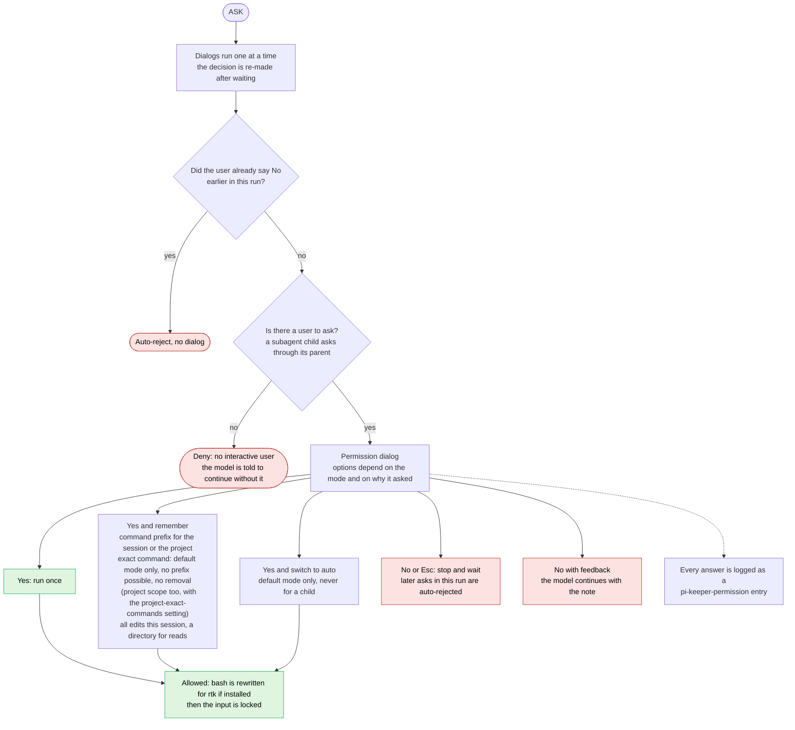
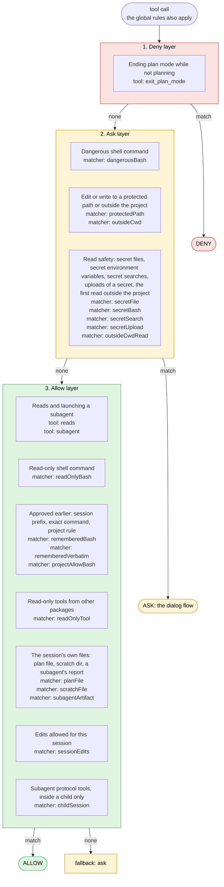
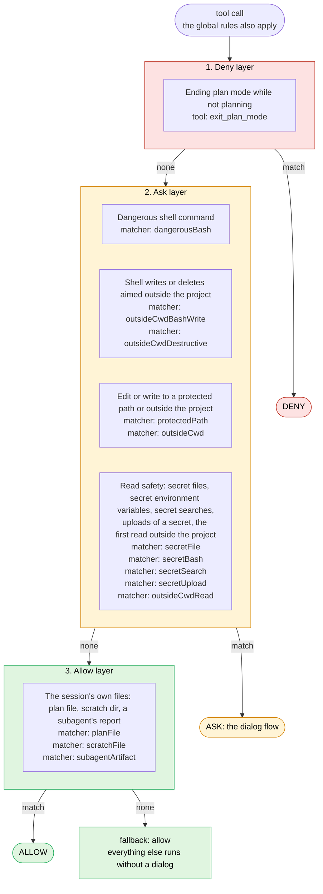
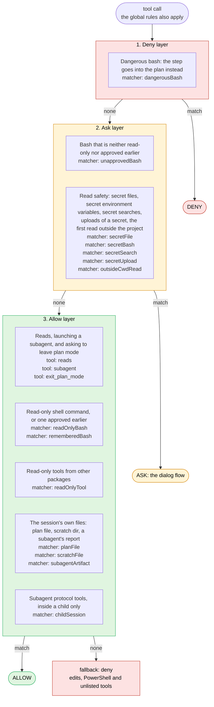

# pi-keeper: design

Why the permission model and plan flow look the way they do. Reading order:
[../README.md](../README.md) (what the user sees) → [architecture.md](architecture.md)
(modules, flows, state, model-facing text, how to change things) → this file
(the reasoning and the threat model). This file does not repeat command lists,
flag tables or dialog labels: those live in code and tests, and each section
says where. When a list and this text disagree, the code wins.

**Non-goals:** containing a hostile model (use a container or VM), judging
whether an action matches the request (there is no classifier), and managing
credentials.

## Decision log

| Decision | Why | Rejected | Section |
|---|---|---|---|
| Strictest of deny/ask/allow wins | An added allow can never loosen a safety check | First-match or ordered rules | 2 |
| Fail closed on anything unparsed | A silent action is worse than a prompt | Heuristic guessing | 1, 5 |
| Allow rules from a cloned repo need a hash review | pi's own project trust auto-trusts files with no risky resources | Trust everything under `.pi/` | 4 |
| Remembered rules are prefixes with arity, never flags | Prefix-on-flags silently widens (`tsc --noEmit *`) | Free-text globs | 7 |
| Dangerous commands: ask (default/auto), deny (plan) | One-time decision must not become standing; planning is research | Rememberable git push | 6 |
| Modes are drawn as deny / ask / allow layers, tied to `MODES` by a test | `evaluate` takes the strictest match, so rule order is not behaviour and an if-chain would invent one; a test keeps the charts true | Hand-drawn if-chains; charts generated from code | 2 |
| Auto mode is a fixed ask list, no classifier | No second model available; inside the project it is deliberately permissive | Per-action judge | 9 |
| Plan renders in the transcript; approval is a tool | Scrollable, searchable, survives resume; the same approval-tool shape other harnesses use | Modal dialog | 10 |
| Plan echoed in the approval result | Compaction can lose incremental plan edits | Pointer to the file only | 10 |
| Declining ends the turn | The model must not push ahead or re-ask | Continue with feedback | 10, 11 |
| The system prompt is constant; the mode travels as a hidden message | A changed prefix flushes the cache and, observed behind a gateway, breaks Claude sessions (signed thinking blocks); the message is the harness discipline Anthropic documents and Claude Code and OpenCode use | Mode text in the prompt; prompt per LLM turn | 10 |
| Model-facing text is short, positive and says what to do next | Small local models lose long, repeated or contradictory rules | Long policy prose in every prompt | 1, 10 |
| Per-session scratch dir | Plan mode needs somewhere to put notes and repros. Reads (not writes) under the system temp dir are allowed too, judged by realpath, with secrets still asking | Allow `/tmp` | 8 |
| Deleting inside the scratch dir is free, the dir itself is not | The files are the session's own; asking for each `rm -rf <scratch>/x` is noise | Treat all `rm -r` outside the cwd as dangerous | 6, 8 |
| Extra read-only tools come from a global file, not the project | A cloned repo must not grant itself tools; names are exact | Project-level list, wildcard names | 2 |
| "Exact command" remember for what no prefix can cover, default mode only | Nearly every dialog is answered Yes; repeated interpreter/compound commands had no remember option; plan stays read-only | Remember interpreters by prefix, share with plan | 7 |
| Exact rules may name interpreters, opt-in project scope via `/keeper` | An exact rule matches one command token-for-token, so `Bash(python3 x.py)` can't silently widen; the session-only exact option left the user re-approving the same interpreters every session | Allow interpreter *prefixes*; persist without a setting (surprise blast radius) | 7 |
| A child may write in the subagent output tree (by real path, never a secret name) | pi-subagents scouts could not write `context.md` and returned everything inline. The artifact id is not the child's run id, so "its own dir" can't be enforced | Allow the whole agent dir to children; match the child's id | 4 |
| Children with no way to ask run auto with `background-auto-fallback`, not useless-default | A headless default child denies every write and command — an orchestrated background worker cannot implement at all; auto's ask list (dangerous, secrets, protected, outside) stays fail-closed, so freedom is bounded. Only matters when background asks are off or the parent has no UI | Project allow-rules (can't cover edits) | 4 |
| Background children ask the parent's user through a file mailbox; the parent re-judges | A child has no UI and pi-subagents offers no permission channel; the request comes from a possibly injected model, so it is never believed beyond the call | A socket; pi's RPC UI channel; pi-subagents' supervisor channel; trusting the child's mode or grants | 4, Background asks |
| Children get skills through a settings override, not through agent files | Every builtin hardcodes `inheritSkills: false`, but `subagents.agentOverrides.<name>` carries the field and wins over any definition, so three lines in `~/.pi/agent/settings.json` do what shadowing would do — and leave upstream prompts, tools and aliases exactly as shipped, so `pi update --extensions` keeps improving them. Verified by asking a `scout` child to list its catalog | Shipping `agents/*.md` in this package (versioned, but we would own three prompts and drift from upstream); new private alias names (collision, and the model keeps picking the advertised builtin); runtime agent registration (no skills field) | 4, Subagents |
| Thinking is always on, medium per role | A single `agentOverrides.worker.thinking: false` made the writer the one agent that never reasoned, decided in settings rather than with the role. Upstream's own levels are the floor now (scout `low`, worker and reviewer `high`), and a settings override or a per-run `model="…:high"` raises it | Per-role levels baked in code; `subagents.defaultThinking` only (leaves `inheritSkills` unfixable) | 4, Subagents |
| A child follows the parent's thinking level, but never below its own | pi-subagents has no "inherit thinking" (`model: "inherit"` inherits the model only), so a parent that went to `high` still launched `medium` children; the level now rides along with the session grants and the child applies the higher of the two. Taking the parent's level exactly would have let a parent at `low` silently disable the role floor the previous decision established | `subagents.defaultThinking` (one fixed level for all children); per-run suffixes everywhere (the parent has to remember); a settings `agentOverrides` block per machine (not versioned, and it beats the role files) | 4, Subagents |

## 1. Principles

- **Accident guard, not a sandbox.** The package stops a well-meaning model
  from doing something you didn't intend. It does not contain a hostile one:
  it can't see through `make deploy`, scripts or aliases, and in auto mode the
  model can edit the project rules file with a command. Use a container or VM
  when that matters. Other harnesses (Claude Code, for one) say the same about rule-based asks.
- **Fail closed.** Anything that can't be parsed or resolved confidently is
  not read-only, not covered by a rule, or denied. The one deliberate
  exception is auto mode's write-outside-the-project check, which lets an
  unresolvable target (`tee $OUT`) run, because auto is an accident guard
  and over-asking defeats it; destructive commands (`rm $X`) still fail
  closed there because the damage can't be undone.
- **Strictest wins.** Several things can apply to one call; the harshest
  decision stands, so adding an allow can never loosen a safety check.
- **Ask costs less than a mistake, but prompts are a budget.** Common choices
  are one Enter away, rare ones sit behind *More…*, and remembered rules turn
  repeated asks into silence, within limits that keep them sound.
- **Directions to the model are short, positive and name the next step.**
  Everything we send the model (mode prompts, tool descriptions and results,
  deny reasons) is read by models as small as 7B. Each instruction lives in one
  place, the place where the model acts on it, and never contradicts what the
  harness does (a rejection that ends the turn is described as "stop and
  wait"). The catalogue and checklist are in
  [architecture.md](architecture.md#model-facing-text).

## 2. Rule evaluation

Each mode (`MODES` in `extensions/modes.ts`) is a **fallback action** plus a
list of **rules**. Every rule that matches a tool call contributes its
action; `evaluate` in `extensions/rules.ts` takes the strictest:
**deny > ask > allow**, the precedence Claude Code uses. If nothing matches, the fallback
applies (default: ask, auto: allow, plan: deny). Consequences:

- An allow rule never overrides a dangerous-command ask, a secret ask or the
  privilege deny. `allow Bash(git push *)` still asks.
- Every tool call goes through the rules, including tools from other
  packages, MCP, PowerShell and codemode tools. Hiding a tool is not treated
  as enforcement.
- Matchers are predicates over the call (`outsideCwdRead`,
  `outsideCwdDestructive`, `secretSearch`, ...); the table in `MODES` shows
  which tool kinds and modes each one asks or denies in.

### Mode rule sets, conceptually

- **default:** reads and read-only bash are free; everything else asks;
  rules (session, project, workflow command) can cover bash.
- **auto:** allow by default plus a fixed ask list (section 9). No rule is
  needed to run things.
- **plan:** deny by default plus an allowlist: reads, read-only bash, the plan
  file and scratch dir, read-only MCP tools. Non-read-only bash asks (planning
  sometimes needs a test run); dangerous bash is denied, not asked, because it
  is never context-gathering and a dialog would invite the model to run it.

The charts under "Behaviour at a glance" draw all three.

### Behaviour at a glance

The charts show what the rule tables in `modes.ts` do. They are drawn as
**layers**, not as an if-chain: `evaluate` takes the strictest matching rule
(deny, then ask, then allow), so an ask below never has to "wait for" an allow
above it, and the order of the rules is not behaviour. Read each mode chart as
*any deny rule matches → deny; else any ask rule matches → ask; else any allow
rule matches → allow; else the fallback*. The global rules (first chart) take
part in every mode, so a global deny or ask beats a mode's allow.

Every rule group node names its rules as `matcher: <name>` or `tool: <name>`
(`tool: reads` stands for the read-only built-ins in `READ_TOOLS`). These tags
are what `tests/unit/mode-charts.test.ts` compares with `MODES` and
`GLOBAL_RULES`, layer by layer, so a rule added, moved or removed in
`modes.ts` fails the test until the chart is updated. The test checks names and
layers, not arrows: re-read the edges when you change one.

**Evaluation core.**


**What an ask does.** Option labels are not repeated here: they live in
`options.ts` and `tests/integration/dialogs.test.ts`.



**default** (fallback: ask): reads and read-only bash are free, everything else
asks, and rules you approved cover bash.



**auto** (fallback: allow): nearly everything runs; a fixed list asks.



**plan** (fallback: deny): an allowlist. Edits, PowerShell and tools nobody
listed are denied by the fallback; a command that is not read-only asks,
because planning sometimes needs a test run.



### Read-only MCP tools

A tool runs without a dialog in default and plan when its annotations say
`readOnlyHint: true` and `destructiveHint` is not `true` (pi reports them via
`pi.getAllTools()`; hints are cached per tool name and refreshed when MCP
servers change). A tool without annotations is not read-only. The matcher
(`NEVER_READ_ONLY_TOOLS` in `rules.ts`) excludes `bash`, `powershell`, `edit`,
`write` and `exit_plan_mode` regardless of claims. The trust is explicit: the
hints are the tool author's claim and aren't verified, so a server that
mislabels a write tool gets it run unasked. Any ask or deny rule still wins.
In plan mode these tools stay active because every mode declares the same
tools, and tools this package doesn't manage (`MANAGED_TOOLS`) are never swapped.

### Read-only tools from other packages

Tools from other packages carry no annotations, so `readOnlyTool` also
matches the names in `readOnlyTools` of `<agent dir>/pi-keeper.json`
(`extensions/config.ts`; defaults `web_search`, `fetch_content`,
`get_search_content`, `source_check`, `code_overview`, `lsp_diagnostics`). `mcp` (it runs any
MCP sub-tool, destructive ones included) and `subagent` can't be listed: the
name hides what runs, so config.ts rejects them with a warning and
`NEVER_LISTED_TOOLS` in `rules.ts` ignores them anyway. Plan mode used to deny these and tell the model to "add it to the
plan", which small models read as a bug, and default mode asked for every
`lsp_diagnostics` after an edit. The file is global only (a project file could
let a cloned repo grant itself tools), names are exact and `NEVER_READ_ONLY_TOOLS`
still wins. A tool nobody listed is denied in plan with wording that says it
is unavailable, not that it belongs in the plan.

## 3. Read safety

### Secrets

Secret files ask in every mode, even when a rule or auto mode would allow the
call, because exfiltrating a credential is not undone by approving once.
Detection: `isSecretFile` (names such as `.env*`, private keys, certificate
bundles; `SECRET_HOME_PATHS` for credential stores under home), `isSecretCommand`
in `extensions/utils.ts`; lists in `extensions/modes.ts`. Public keys and
`.env.example`-style templates don't ask. A glob that could match a secret
(`cat .en*`) asks.

Two further classes reach secrets without naming them:

- **Searches** (`secretSearchHits`): recursive `grep`, or `rg`/`fd` run
  with flags that disable ignore rules or include hidden files, over a tree
  that actually holds a secret. This asks even when a rule covers the
  command. Plain `rg KEY` stays silent on purpose: ripgrep skips hidden and
  git-ignored files by default, so a `.env` isn't read (non-hidden secret
  files such as `id_rsa` are the exception, which is why the tree walk
  checks for them). The walk is bounded (depth and entry count, `.git`,
  `node_modules` and the dependency/vendor directories in `SEARCH_SKIP_DIRS`
  skipped); hitting a bound or an unresolvable search path asks rather than
  guesses. The bounds are generous (16 levels, 200 000 entries) so that a real
  project — a benchmark suite with demo apps is tens of thousands of files —
  is checked instead of asking because of its size.
- **A secret file git tracks is repository content** (`isTrackedFile`): a
  project that commits demo certificates or a template `.env` would otherwise
  ask on every recursive search in it. The check runs `git -C <the file's own
  dir> ls-files --error-unmatch -- <name>`, so a file inside a submodule is
  judged by the submodule and a file in a nested repository by that one. It
  applies only under a directory the session may read (the cwd, or a granted
  read directory); an untracked file — the `.env` you keep locally, usually
  gitignored — still asks, and so does every secret in a tree the session may
  not read. No git, no repository or an error answers "not tracked", so the
  search asks. Answers are cached per file (`TRACKED_CACHE_LIMIT`).
- **Uploads** (`secretUploads`): `curl`/`wget` options that send a file body
  where the file is a secret. Uploads of other files are untouched; this
  is the narrow egress check that exists, and it applies in auto too.

### Outside-the-project reads

A read outside the cwd asks once, and the answer can become a **directory
grant** (`readGrantDir` in `utils.ts`; cases in
`tests/unit/read-grants.test.ts` and `tests/integration/read-grants.test.ts`).
Design points:

- The grant covers the read file's parent directory and below, not siblings or
  ancestors: granting `/etc/` after `cat /etc/hosts` is the smallest useful
  unit.
- Containment is judged on real paths, so a symlink leading out of the
  granted directory is not covered, and `..` can't climb out.
- `/`, the home directory and every ancestor of home are never offered as a
  grant: one answer would cover nearly everything. Those asks offer *Yes* and
  the blanket *for this session* option only. A grant arriving from a subagent
  child is re-validated by the parent (absolute, existing, real path, never
  `/` or a home ancestor), because the child process is not trusted.
- Secrets and secret searches inside a granted directory still ask (strictest
  wins) — except a secret git tracks, which is repository content (see
  "Searches" above).
- Only words that look like paths and exist on disk count, so `rg '/api/v1'`
  doesn't ask.
- `outsideCwdRead` is listed before `secretSearch` in `READ_SAFETY_RULES`.
  Both are asks, so the order only decides which dialog appears: a recursive
  search over another tree shows the ask that offers that directory (the gate
  it would unlock) instead of a secret ask with no lasting option.
- A `cd` target is not a read. Changing directory is a plain (not read-only)
  command, so its ask is the fallback's and a `cd` rule covers it; the
  outside-reads gate only lifts to a directory grant, so counting a `cd` there
  would leave every `Bash(cd *)` rule without effect. The units after the `cd`
  are still judged in order (`changedDir`, like `isDangerousCommand`), and one
  running in a directory outside the cwd reports that directory: `cd ../other
  && cat notes.md` asks, `cd ../other && echo hi` does not.
- Exempt without asking: the plan file, the scratch dir, pi's agent dir
  (skills, prompts, sessions), the skill directories the current prompt names
  (`skillDirsFromPrompt`), and pi's own output files. The skill exemption is
  exactly "the files the model was told to read": pi renders every skill as a
  `<location>` in the prompt's `<available_skills>` block, and the lists in
  this machine's `~/.agents/skills` live outside every project's cwd, so
  without it an inherited skills catalog costs one dialog per skill — and in
  plan mode a child could not open it at all. It is derived from the prompt
  rather than from a hardcoded root list, so a new skills location needs no
  code change here and nothing outside the catalog becomes readable; secrets
  inside a skill directory still ask. The output-file exemption exists
  because pi writes the full text of truncated tool output to the OS temp dir
  (`pi-bash-<hex>.log` and the like) and tells the model to read it. The check
  (`isPiOutputFile`) is deliberately narrow: a regular, non-link file owned
  by you, directly in that dir, with pi's generated name. Anything looser
  would turn the temp dir into a free-read zone.
- Fetch grants (`fetchHost` and `fetchGrantHosts` in `utils.ts`; cases in
  `tests/unit/fetch-grants.test.ts` and
  `tests/integration/fetch-grants.test.ts`) use the same classification hook:
  a curl/wget GET to a granted host is a read-only segment (there is no
  built-in host list; a session grant, a `Fetch(<host>)` project rule or an
  allow rule is the only way in), so `readOnlyBash`, `unapprovedBash`,
  coverage and the dialog's "Why" line all agree without a new rule in the
  mode tables. Eligibility is fail-closed. `scanOptions` must know every
  flag. Nothing may be sent besides the URL: no body, upload, cookie file,
  proxy, `--resolve`/`--connect-to`, or method other than GET/HEAD. Every
  URL must be absolute http(s) with no userinfo and no `$` or backtick. The
  response must go to stdout (`-O -` for wget). A segment fed by `xargs`
  never qualifies. Hosts are exact (a subdomain is another host) and
  lowercase. The grant is per host rather than "any GET" because the URL
  itself can carry data out. The dialog offers a host only when granting it
  is what removes the ask (`fetchGrantHosts` re-runs the classification), so
  a POST or a pipe into `make` gets no host option. A dangerous flag such
  as `--insecure` still asks, or is denied in plan mode, because the
  strictest rule wins. Hardening on top of that:
  - `-L` follows redirects (GET only; curl drops auth headers on cross-host
    redirects).
  - `--location-trusted`, `-E`/`--cert`/`--key` and any `@file` value
    disqualify the auto-allow.
  - A `-w '%output{FILE}'` is judged as a write.
  - URLs need a plain ASCII authority, with no `\`, `@` or `%` in the host.
  - A drift test pins the classification of every curl flag.
- Grants last until a new session starts (`/new`, `/resume`, fork) or pi exits
  and are never persisted: a directory you trusted today is not a durable
  policy.

## 4. Trust boundaries and threat model

Who is trusted, and what each input can do:

- **You** (dialogs, `/permissions`, your hand edits): full authority.
- **The model**: acts within the rules; it can edit files and run commands as
  allowed, including (in auto mode) the project rules file. Its tool input is
  never trusted to be what it looks like (heredocs, wrappers, `$(...)`,
  `xargs`, variable-held `sudo`).
- **A cloned repository**: may ship `.pi/settings.local.json`, prompt
  templates and `.pi` content. It must not be able to pre-approve commands.
- **Another extension**: may rewrite tool input after our decision.
- **A subagent child process**: runs the same code but its registry and UI
  messages are treated as input to be validated by the parent.

### Project rules and the trust gate

pi's own project trust can't protect `.pi/settings.local.json`: projects with
no risky resources are auto-trusted, so a cloned repo could carry `allow`
rules that run silently. Hence the gate (`extensions/project-rules.ts`,
`loadProjectRules`, `recordTrust`, `fileSignature`):

- `<agent dir>/pi-keeper/trusted-rules.json` maps the file's absolute
  path to the sha256 of its content, recorded when this package writes the
  file and when you approve a review. The same store holds the project's
  rulebook files (below): one path-to-hash map for every file that can change
  what the model is told or allowed to do.
- `deny` and `ask` rules load regardless: they only tighten, so a malicious
  file can't gain anything from them. A file that exists but cannot be read or
  is not valid JSON fails closed: the `projectAsk` matcher makes every shell
  command ask, in every mode, until the file is fixed, so a broken file never
  silently drops your rules.
- `allow` rules load only when the hash matches; otherwise a review dialog
  lists them (*Load them* / *Ignore for this session*), checked at session
  start and before every prompt. Without a UI they are ignored.
- The file is re-checked on every decision, so a mid-run change (by the model
  or anything else) leaves new allow rules inactive until reviewed.
- Our own writes record the new hash only if the content they replace was
  already trusted. Otherwise saving one rule would bless every unreviewed
  rule next to it; instead those stay under review and the new rule applies
  for the session only.
- Writes are atomic (temp file + rename), merge into the existing JSON, and
  never overwrite a file that isn't valid JSON. The file path is added to
  `.git/info/exclude` (worktrees and submodules resolved to the common git
  dir; `.gitignore` untouched) so personal permissions don't leak into
  commits.
- Known limit: in auto mode the model can *remove* `deny`/`ask` rules by
  editing the file with a command; that loosening needs no review. Added
  `allow` rules do.

Project `allow` rules are held to the same limits as "Yes, and always allow"
(no interpreters, runners, removals, privilege commands) so a hand-edited rule
can't grant what the dialog would never offer. `ask` rules also match inside
`sh -c`, `eval`, `$(...)` and `rtk proxy`, and skip flags between tokens
(`git -C x push` matches `git push *`), because a deny/ask that a wrapper
bypasses is worthless.

### The rulebook: project text that instructs the model

A rulebook rule (`extensions/rulebook.ts`) is a Markdown file whose body is an
instruction, and a project one lives in `.pi/rules/*.md` — so it is the same
threat as a project `allow` rule, pointed at the model instead of the gate. It
gets the same gate: the user's own directory
(`<agent dir>/pi-keeper/rules/`) loads freely because the user wrote it;
a project file loads only when its content hash is recorded
(`trustedHash`, `recordTrust`), reviewed once for the whole set of changed
files at session start and before every prompt, *Load rules* / *Ignore for
this session*. An unreviewed file is not even parsed into a rule. Unlike
`settings.local.json` a project rule file is meant to be committed, so it is
not added to `.git/info/exclude`. The model-facing text of a project rule
never enters the prompt (see the next section), so a rule the user has not
reviewed cannot change behaviour at all.

Also unlike permission rules there is no fan-out: a rule fires once per
session, each body is capped (`RULE_BODY_CAP`, so one long rule cannot crowd out a second
rule that fired with it) under a whole-message ceiling (`RULE_TEXT_CAP`), and an uncompilable `condition`
is skipped with a warning. The one new cost is a user-written regex, which runs
synchronously inside an awaited turn boundary, so it is only ever handed the
last `RULE_SCAN_CAP` characters of an answer.

Why a regex and not a judge model: a fire must be reproducible and free, and the
habits worth catching first are wording habits. The order of escalation — regex,
then a fact check against the turn's tool results, and only then a judged
`question:` — with the reasoning and the cost of each, is in
[rulebook.md](rulebook.md#follow-up-in-the-order-i-would-do-it).

### Workflow-command grants

`allowed-tools` in a prompt template is code-execution consent like a project
allow rule. User templates are yours; project templates load only after pi's
project trust. A grant is picked up from the user-typed `/name` (matched
against pi's prompt templates, so an extension command of the same name wins
and grants nothing; skills are never read), covers the same set as a project
rule, applies in default mode only, and is cleared at `agent_end` and at the
next user input. Input queued while the agent runs neither starts nor ends a
grant, so a steer can't extend a run's authority.

### Approved means unchanged; the rtk exception

After you approve a bash, PowerShell or file-tool call its input is locked: a
later `tool_call` handler from another extension that changes it makes the
call fail, naming the field, rather than run something you didn't see. Calls
allowed by rules without a dialog are not locked, so extensions that rewrite
commands (adding `rtk`) keep working. The single exception is this package's
own `rtk rewrite` (`extensions/rtk-rewrite.ts`): rtk is a
semantics-preserving optimizer, so the rules and the dialog see the original
command and what runs may be its rtk equivalent. The trust is scoped to the
rtk binary invoked here; it is skipped if rtk is missing, too old, or
disabled (`RTK_DISABLED=1`), and the lock holds absolutely afterwards.

### Subagent relay trust model

Code: `extensions/subagents-bridge.ts` (`registerChildMode`, `childModeFor`,
`REGISTRY_KEY`), `extensions/ui-relay.ts` (`registerUiRelay`, `findUiRelay`,
`RELAY_KEY`), `extensions/child-plan.ts`, `child-default.ts`,
`child-auto.ts`; tests
`tests/integration/child-relay.test.ts`, `tests/integration/subagents.test.ts`,
`tests/unit/ui-relay.test.ts`, `tests/unit/subagents-bridge.test.ts`.

- Children follow the parent mode but never exceed it: plan → plan,
  default → default; auto → default, or auto when the `/keeper`
  setting (`subagentsFollowAuto` in `<agent dir>/pi-keeper.json`, default
  off) enables it — and then only where the child's asks can reach the
  user: `child-auto.ts` checks whether the child's asks can reach a user (the
  parent's UI relay, or the parent's mailbox for a background child, see
  [Background asks](#background-asks)) and falls back to default when they
  cannot. The reasoning: auto means "a trusted task the user is watching"; a
  foreground child's asks relay to the parent's dialog and a background
  child's asks open one in the parent's session, so the user is still
  watching; a child whose asks would be denied, not asked (background asks
  off, a parent without a UI, which never listens), must not run with that little oversight. A
  child can't switch modes.
- The `background-auto-fallback` setting (default off) deliberately lifts that last
  rule for children with no way to ask: with it on, such a child runs in
  auto mode instead of default, whichever entry loaded it
  (`child-default.ts` and `child-auto.ts` share `relaylessChildMode`). With
  background asks on it has no effect: the child follows the parent's mode
  and asks. Why the setting exists: a background
  default-mode child is not safer than a background auto child — it is
  *useless*: every write and every non-read-only command is denied, so an
  orchestrated background worker cannot implement at all (observed in the
  wild: workers staging deliverables in scratch dirs and timing out on
  `contact_supervisor`). Auto mode is the bounded middle: edits and
  in-project commands run unasked, while dangerous commands, secrets,
  protected and outside paths still ask and therefore still deny
  fail-closed — the ask list is the safety bound, not the dialog.
  Foreground children with a relay are unchanged (their asks still open
  the parent's dialog), so the setting only widens what nobody was
  watching anyway. Blast radius: the setting is global, so it grants
  unattended writes in whatever project an orchestrator dispatches a
  background child to; a per-project opt-in (the child cwd's
  `.pi/settings.local.json`, with its trust-hash gate) is the future
  hardening path if that proves too broad. Piping a background child's
  asks to the parent's UI through pi-subagents is out (it states that
  environment-only permission extensions cannot safely forward ask requests
  for runner children); the file mailbox below is how asks reach the user
  instead.
- The package registers the child extension in pi-subagents'
  required-child-extensions registry for the session (on start, on every mode
  change, cleared at shutdown). Both the registry and the UI relay are
  process-global registries (`Symbol.for` keys): same-process code is
  trusted, which is why they only exist for foreground children running in
  the parent process. A background child is a separate process and cannot
  reach them; it uses the mailbox, whose input is untrusted.
- A child has no UI, so its asks are relayed to the parent's dialog. Fail
  closed everywhere: no relay or mailbox, a parent without UI, a malformed
  registry or a failing relay denies the ask with a reason the agent can report; the
  `subagent` tool itself is denied in every mode when registration failed,
  since an unregistered child would run unchecked. For the same reason
  agents configured for another runner or machine are refused.
- Answers share state both ways (session rules, edit flag, outside-read
  flag, granted directories, fetch hosts) because the user approved them for the session,
  not for one process. The parent re-validates anything a child sends back
  (see directory grants above) and keeps denying dangerous commands and
  privilege escalation in plan-mode children with no dialog.
- Rules a child reads from and saves to come from the child's own working
  directory, so a rules file is the one that governs that cwd.
- The relay never offers *switch to auto mode* to a child.
- A child may `write`/`edit` report files under
  `<agent dir>/sessions/<dir>/subagent-artifacts/outputs/<id>/`
  (`isSubagentArtifactPath`, matcher `subagentArtifact`, allowed in every
  mode, exempt from `protectedPath`/`outsideCwd`). pi-subagents tells a scout
  to write `context.md` there; without this plan mode denied it and a
  default-mode child was refused as `no-ui`, so the scout returned the whole
  report inline. Limits, in order of how they are enforced: only children
  (`ctx.child`); only `write`/`edit`; the path is resolved and then realpath'd,
  so `..` and a symlink in the tree that points elsewhere don't count (as for
  the scratch dir); a secret file name is not a report (`isSecretFile`: ask in
  default/auto, denied by plan's fallback). **Not enforced:** that the dir is
  the child's own. The `<id>` in the artifact path is not the child's run id, so there is
  nothing to match it against; one child can overwrite another's report. The
  parent session and everything else in the agent dir keep their rules.

### Background asks

Code: `extensions/ask-mailbox.ts` (schema, hardened I/O), `ask-server.ts` (the
parent), `remote-relay.ts` (the child), `ask-heartbeat.ts`, `secure-file.ts`,
`dialog-lock.ts`, and in `index.ts` `askTheParent`, `judgeRemote`, `askRemote`,
`startAsks`; tests `tests/unit/ask-mailbox.test.ts`, `ask-server.test.ts`,
`ask-heartbeat.test.ts`, `remote-relay.test.ts`, `dialog-lock.test.ts`,
`tests/integration/background-asks.test.ts`.

A background child (`async: true`) is a detached pi-subagents runner with no
UI. Denying everything it cannot decide made it useless (see `background-auto-fallback`
above) and handing it auto mode made it unsupervised; neither answers the
real question, which is *what does the user say about this call*. So the child
files the raw tool call and waits, and the parent's user answers in the
dialog they already know.

**Trust model: the child asks, the parent decides.** A request is untrusted
input: the child's model may be prompt-injected, and a file in a directory
two processes share is only as honest as whoever can write to it. So the
parent believes nothing in a request beyond the tool call, its working
directory, a display label and a pid:

- It re-judges the call with its own rules, grants and project rules (the same
  `decide` as for its own calls) and answers `allow` or `deny` without a
  dialog when those settle it. Only an `ask` verdict reaches the user.
- The reply is only `allow`, `deny` (with a fixed reason) or `cancelled`. A
  child never sends a grant. If the user picks a remembering option, the
  parent applies it itself and the child sees it through the session-grant
  snapshot (`session-grants.ts`) on its next call.
- The mode is the parent's choice, not the child's claim: a call is judged in
  the **stricter** of the mode the parent assigns that child
  (`backgroundChildMode`: the registered mode, with `subagentsFollowAuto` and the
  relay-less rules applied) and the mode the request says (plan > default >
  auto). A child that fell back to default is never judged as auto, one that
  claims auto under a default parent is clamped, and the mismatch is logged
  (`clamped`). The label shown in the dialog is sanitized (no control, bidi or
  zero-width characters, 80 characters) and the dialog says `Background
  subagent <name>:` so the user knows whose call it is.
- The child's cwd gets the same lockdown as any child (`child-cwd.ts`).
- Options that need a channel the child lacks are not offered: *No, and tell
  the agent* (a note cannot travel back), *switch to auto mode*.

**Why a file mailbox.** The channel must work between two unrelated pi
processes that share only the filesystem and a session id in an environment
variable, with no cooperation from pi-subagents:

- A *socket* needs a listener address both sides agree on, a lifecycle (stale
  sockets, a port or path to clean up) and authentication that a unix
  socket's peer-credentials check only partly gives; a file under the agent
  dir reuses the one trust boundary we already have (below) and fails by
  being absent.
- *pi's RPC UI channel* connects a pi process to the client that hosts it. The
  runner is not an RPC child of the parent session, so there is no channel to
  borrow and the parent's UI is not addressable from it.
- *pi-subagents' supervisor channel* (`contact_supervisor`) carries a model's
  words to the parent *model*. It is not a permission path: the answer would
  come from the agent, not the user, and pi-subagents states that
  environment-only permission extensions cannot safely forward ask requests
  for runner children.

Polling costs latency (the parent polls every 500 ms, the child every 250 ms)
and buys independence from fs-watch semantics, which differ per platform and
miss renames over some filesystems. What one poll costs is measured, not
guessed, in section 14.

**Hardening.** The directory
`<agent dir>/pi-keeper/asks/<sha256(parent session id)>/` holds
`requests/`, `replies/` and `cancels/`, one JSON file per ask id.

- *Where the boundary is.* `<agent dir>/**` is a protected path (`isProtectedPath`):
  the child's own `write`/`edit`/`bash` calls there ask, and the parent
  trusts nothing from the child but the call it judges. The mailbox is
  hardened against accidents and against a blind or stale writer, not against a
  same-user process that can already write the agent dir by other means (a
  user-approved edit, another program): it is not a sandbox, as stated under
  Non-goals.
- *Every read is `lstat` + `O_NOFOLLOW`*: regular files only, owned by us, at
  most 64 KB, plain JSON with strict validation (no unknown or extra keys,
  limited depth and key count, no `__proto__`/`constructor`/`prototype`, a
  UUID id, a 32-hex nonce, a tool name pattern, no control or bidi characters
  in the label or cwd). Writes are a fresh random-named tmp opened `O_EXCL |
  O_NOFOLLOW`, mode 0600, then `rename`.
- *The symlink walk.* `ensureSecureDir` creates the chain one level at a time
  and checks every component below the agent dir (`pi-keeper`, `asks`,
  the session hash, `requests`/`replies`/`cancels`): each must be a real
  directory, not a symlink, and ours; a looser mode is tightened to 0700
  through an open descriptor. Anything else refuses the mailbox, so nothing is
  ever created behind a symlinked ancestor.
- *Claim-by-rename.* The parent takes a request by renaming
  `<id>.json` to `<id>.json.taken`. Rename is atomic, so exactly one taker
  wins and a request is handled once; the parent's receive time (not file
  mtimes, not the child's clock) starts the TTL.
- *Nonce-bound replies.* Each request carries a random nonce. The parent
  echoes it, and the child accepts a reply only when the nonce matches **and**
  the `.taken` file exists, after deleting any stale reply before filing. A
  reply pre-created blind, or left from an earlier ask, does not match.
- *Caps.* At most 64 files per poll pass, 64 KB per file, 100 requests held
  (more are denied unseen with reason `rules`), a TTL (the child's timeout plus a minute, at least 15 minutes) after which
  the request is denied `timeout`, and a sweep of leaked tmp files and of
  requests whose child pid is gone. A request that would not fit in 64 KB is
  denied by the child without being filed.
- *Terminal lifecycle.* `stop()` replies `parent-session-ended` to everything
  pending and closes the dialogs; a child with a dead pid is dropped; a child
  that times out or is aborted files a cancel so a dialog for a call nobody
  waits for closes.

**The heartbeat and the fast deny.** A child that wrote a request and waited
for a parent that never started its server (an older version, background asks
off, no UI to answer on) or has stopped it would sit out its whole timeout. So the parent keeps
`<askDir>/alive` (`{v:1, pid, at}`) fresh every 10 s while its server runs, and
removes it at `stop()`. A child asks only if the file is fresh (under 15 s),
names the pid that published the session-grant snapshot (a stamp more than 3 s
in the future, `MAX_AHEAD_MS`, is rejected as not fresh), and is checked again
on every poll; otherwise it denies **at once** with a clause the agent can
report ("the parent session has ended"). The same check, run at child launch,
decides the child's mode (default when nothing listens). A parent without a
UI (`pi -p`, RPC) starts no server, so it writes no heartbeat and its children
fall back at launch; the server's `no-ui` reply only covers a parent that
loses its UI with asks pending. The env kill switch
`PI_KEEPER_BACKGROUND_ASKS=0` and the `background-asks` setting both stop
the server, hence the heartbeat, hence the fast deny.

**Popup policy.** A dialog from a child must not steal what the user is
typing or interleave with another dialog. One dialog is open at a time
(`dialog-lock.ts`: pi has a single editor slot and a second dialog would
replace the first, leaving its promise unsettled). `backgroundAskPopup`
(`always` by default) opens a dialog, with the bell, as soon as no other dialog
is open. `idle` opens it only when the session is idle and the editor empty;
otherwise a footer badge says `N background
approvals waiting · /approvals`, and the queue opens at the next idle point
(`agent_end`). `always` and `badge` are the two ends; `/approvals` opens
waiting asks on demand. Esc denies that one call; the child carries on
without it. Every queued request is judged again on each pass, so one grant
settles identical waiting requests without a second dialog.

"Idle" is `ctx.isIdle()`, which is false for the whole of any tool call, not
just for the parent's own dialogs: a `subagent` wait on a background run
(minutes), a long foreground command, a slow MCP call. A parent that spends
its time inside such calls never reaches an idle point, so `idle` shows the
badge and no bell, and an ask whose child hits `backgroundAskTimeoutMs`
first is denied unseen — the child sees a timeout while the user saw nothing
at all. That is measured, not theoretical (a session's asks that arrived
inside a wait were cancelled at their timeout, while every ask that arrived
between tool calls was answered). Hence `always` for an orchestrating
parent; `idle` suits a parent that mostly sits between turns.

**Known limits.**

- Latency: a reply is seen after up to about 0.5 s (both ends poll), plus the
  wait for an idle point under the `idle` popup policy.
- A parent whose event loop is blocked synchronously for more than 15 s stops
  refreshing its heartbeat, so its children see it as gone and deny at once,
  even though the user could still answer afterwards.
- The lane text a child is told (`childLaneLine`) is frozen at session start,
  to keep the child's prompt prefix stable; if the user toggles background asks
  later, the text no longer matches until the next child. The deny text it
  gets is always current.
- *No, and tell pi what to do instead* is not offered for background asks: the reply
  carries a decision only, so a declined call tells the child to continue
  without it, nothing more.
- A grandchild (a child launched by a background child) names a child session
  that publishes no snapshot, so it cannot ask and is denied.
- A same-user process that can write the agent dir is outside the model (see
  Non-goals).

## 5. Read-only classification

The classifier decides what runs without asking in default and plan, so a
mistake here is a silent action. Entry points in `extensions/utils.ts`:
`isReadOnlyCommand`, `readOnlyBlockers`, `approvalBreakdown`, all built on
`segmentBlocker` (the single source of truth for why a segment is not
read-only). Allowed commands: `READ_ONLY_BASH_COMMANDS` and the per-tool
subcommand tables (`READ_ONLY_GH_*`, `READ_ONLY_KUBECTL_SUBCOMMANDS`,
`READ_ONLY_CONTAINER_SUBCOMMANDS`) in `extensions/modes.ts`. Behavior is pinned
by `tests/unit/utils.test.ts`.

Philosophy:

- **Allowlist, per segment, fail closed.** Commands are split on `;`, `&&`,
  `||`, `&`, `|` and newlines respecting quotes, and *every* part must pass.
  Anything not confidently understood (unbalanced quotes, over-long input,
  an unknown flag, an unparsed `sed` script) is not read-only. Allowing a
  command means allowing a *shape* of it: `sort` yes but not `-o`, `tail`
  but not `-f`, `find` without `-exec`/`-delete`, `rg` without `--pre`.
- **Syntax that moves data or code is rejected wholesale:** redirection to
  real files, input redirection, heredocs, substitution and subshells. The
  exceptions are narrow and enumerated: `/dev/null`, fd duplication, a
  literal absolute path in the scratch dir, and the commit/PR body heredoc
  (see section 7).
- **Unquoted globs on write-capable commands are rejected** (`find *`):
  a file named `-delete` would expand into a flag. `GLOB_SENSITIVE_COMMANDS`.
- **Wrappers** (`WRAPPERS`: `timeout`, `time`, `nice`, ...) and known-safe env
  assignments (`SAFE_ENV_VARS`) are stripped before matching, as Claude Code
  does. Any other assignment, `env`, and `sudo` are never stripped, because an
  assignment like `LD_PRELOAD=` changes what runs.
- **`sed`** is allowed only for scripts the analyser fully understands (the
  print/delete/quit family, `y///`, `s///` with harmless flags). `e`, `w`,
  `r`, `R`, `a`, `i`, `c`, labels and anything unparsed are rejected;
  `r`/`R` could read secrets or files outside the cwd. `-i`/`w` are
  *write-effect* (a rule covers them while targets stay in the project);
  `e`, `-f` and unparsed scripts are *exec-effect* (never covered).
- **`awk`** is read-only only with a command-line program that cannot reach
  outside the pipeline (`awkBlocker`). `-f`, `-i`/`--include`, `-l`/`--load`
  and any flag not analysed are rejected; the program text is rejected when it
  contains `system(` (also inside a regex or a string: fail closed), `getline`,
  `@include`/`@load`, a single `|` (a pipe into a command; `||` is a
  comparison) or a `print`/`printf` with `>`/`>>` (a redirect). Strings and
  `/regex/` literals are blanked before the pipe and redirect checks, so
  `awk '$1 > 2'` and `awk '/a|b/'` stay read-only — the shapes a model uses to
  number the lines of a file slice, which used to cost one dialog each. `awk`
  stays in `INTERPRETERS`: an unsafe program is never offered a prefix or an
  exact rule. Outside-read, secret and write rules still judge the whole
  command, so a read-only `awk` opens no path.
- **`xargs` never makes an argument-sensitive tool read-only.** Words from
  its stdin are appended to the command, so the arguments that were checked
  are not the ones that run. Bare `xargs` is a stripped wrapper only for
  tools where that doesn't matter; for `git`, `gh`, `kubectl`, `docker`,
  `podman`, `env` and `printenv` it is not read-only.
- **Service CLIs: query forms only, and no flag before the subcommand.** A
  global flag can redirect the call to another target or credential:
  - `kubectl`: `--kubeconfig`, `--server`, `--token`, `--as*`, `--context` and
    TLS flags (a kubeconfig can run a credential plugin); `--raw` and
    `--profile*` (arbitrary API path or a file write); `get|describe -f/-k`
    (a manifest may be a Secret); and reading Secrets themselves
    (`get secret`, `get pods,secrets`), which prints credentials.
  - `docker`/`podman`: connection and host flags (`-H`, `--context`,
    `--remote`, `--identity`, ...) point the client at another daemon.
  - `gh api` is read-only only as a plain GET: field/input flags, a method
    other than GET (including by override header), `--hostname` (another
    host, possibly with the token) and full `http(s)://` endpoints change
    what is sent where. `gh ... --web` opens a browser. The write forms land
    in the dangerous list.
  - `env`/`printenv`: bare forms dump the whole environment, and a name
    matching a credential pattern (`KEY|TOKEN|SECRET|PASS|CRED|AUTH`) asks.
    `env cmd` runs `cmd`.
- **git** is read-only only in list/inspect forms; `-c`, `--exec-path`,
  `--output`, and `-C`/`--git-dir`/`--work-tree` pointing outside the cwd or
  into a nested repo are rejected. A nested repo's hooks and
  `core.fsmonitor` would run when git is invoked there, so a `cd` into a
  different repo makes even read-only git not read-only. Same repo
  (`cd sub && git status`) is fine.
- **rtk:** 1:1 proxies are analysed as the real command; rtk's own
  commands and unknown global flags are not read-only (section 6).

## 6. Dangerous commands and denied privilege escalation

`DANGEROUS_COMMANDS` in `extensions/modes.ts`, detection by
`isDangerousCommand` in `utils.ts` (it also finds commands inside `sh -c`,
`eval`, `$(...)`, `xargs`/`find -exec`, `rtk run|proxy`, behind wrappers and
env assignments, and in heredoc/here-string bodies that a shell or an
unquoted expansion would execute). Based on Claude Code's auto-mode block
list. Categories: irreversible or shared-state git (push, hard resets,
force flags, `config` writes that make git run code such as `core.hooksPath`,
`alias.*`, `credential.helper`), `rm`/`find -delete` on critical or
unresolvable paths, download-and-run and anything piped into a shell,
publishing, infrastructure apply/destroy, safety-off flags, tunnels, and
system commands.

Why they behave as they do:

- **Ask in default and auto, never remembered:** a "don't ask again" on
  `git push` would turn a one-time decision into a standing one, and the
  prefix would cover force pushes. Strictest-wins keeps even an `allow` rule
  from silencing them.
- **Denied in plan:** a plan is research. A dangerous step is never
  context-gathering, so there is nothing to approve; the model is told to put
  the step in the plan, where you review it.
- **`rm` inside the session scratch dir is not on it** (the dir itself still
  is): the files are the session's own, so a dialog for
  `rm -rf <scratch>/x` is noise (section 8).
- **`git config` is on the list** for keys that make git execute code
  (hooks path, fsmonitor, ssh command, pager, editor, aliases, textconv,
  drivers, credential helpers, includes): setting one is code execution on
  the next git call. Reads and `--unset` don't ask.
- **Privilege escalation** (`sudo`, `su`, `doas`, `pkexec`, `run0`, or a
  variable holding one: `x=sudo; $x ...`) is denied in every mode, auto
  included (`isPrivilegedCommand`, `PRIVILEGE_REASON`). The model can't
  type a password and the point is that you run it yourself (`! <command>`).
- **Not a security boundary:** the list can't see through `make deploy`,
  `npm run release`, scripts or aliases.

### Protected paths

`PROTECTED_DIRS` / `PROTECTED_FILES` in `modes.ts`, `isProtectedPath` in
`utils.ts`. These are files whose modification changes how later commands
behave (`.git/`, `.husky/`, `.vscode/`, shell rc files, `.npmrc`, `.envrc`,
`.mcp.json`, pre-commit configs, and pi's own agent dir `~/.pi/agent/`:
settings, extensions, sessions): editing them is a persistence vector, so
they ask in auto and default. The session plan file and the scratch dir
(including a repo cloned into it) are the exceptions.

## 7. Remembered commands

"Yes, and don't ask again" and "Yes, and always allow" store a *prefix*, and
the design question is when a stored prefix may silently cover a later
command. Code: `deriveCommandPrefixes`, `patternLadder`, `isCoveredByPrefixes`
and `approvalBreakdown` in `extensions/utils.ts`; tables in `modes.ts`; cases
in `tests/unit/utils.test.ts` (search `patternLadder`, `isCoveredByPrefixes`).

### Canonical rtk form

`git add` and `rtk git add` are the same rule in both directions, so rules
survive the model switching between forms and old rules keep matching
(`canonicalize` in `utils.ts`). `rtk` is stripped only for 1:1 proxies of the
same-named command (the set is in `modes.ts` next to `RTK_RUNNERS`) and
`rtk proxy <cmd>`. rtk's own commands and name collisions (`read`, `test`,
`ls`, `find`, `grep`, `env`, `run`, ...) and renames keep their `rtk` form,
because treating them as the real command would apply the wrong semantics.
Only `-v...`/`--verbose`/`--ultra-compact` are skipped as global flags: an
unknown one leaves the rtk form as it is, hence not read-only and not
coverable by a non-rtk rule.

### Prefix depth (arity)

A prefix names a command, not a flag set. `COMMAND_ARITY` in `modes.ts`
(adapted from OpenCode's `arity.ts`, MIT) gives how many leading tokens name
a command (`git commit`, `gh pr create`, `docker compose up`,
`npm run build`); unlisted commands use the command alone. No prefix is
derived when the command is shorter than its arity (`gh pr`) or a flag falls
inside the window (`git -C x commit`, `docker compose -f x up`), because a
prefix there would silently cover a different command. `run`/`exec`/`x`/`dlx`
subcommands include the program (`docker exec c`), and interpreters behind
them (`uv run python`) are refused.

### Pattern ladder

*Allow a different command pattern…* (`patternLadder`) offers, narrowest
first: the **exact** command, then prefixes down to the command itself, then a
typed pattern. Why:

- Only the exact choice names flags, because prefix matching on flags is
  unsound (`tsc --noEmit *` would cover `--outDir x`). It is dropped when a
  word has spaces, quotes, `$`, a glob or other shell syntax, since such a
  command can't be saved as a rule.
- Prefixes never contain flags, and a prefix whose next word runs programs is
  not offered (`npm run build` gives no `npm *`). Prefixes shorter than the
  usual depth are labelled *(broad)*.
- It is offered only when exactly one part of the command needs approval;
  for `npm test && git commit` a single pattern can't express the choice.
- A typed pattern is held to the same limits as "always allow"; an invalid
  one is reported and the call is allowed once.

### Exact rules in project scope

The "exact command" option (no prefix possible — an interpreter such as
`python3 x.py`) is session-only by default. The `/keeper` setting
`project-exact-commands` adds *Yes, and always allow this exact command in this
project*: the same choice, saved as an exact rule (`Bash(python3 x.py)`) to
the project file with the usual trust recording, so it loads silently on
the next start. Code: `exactRuleTokens` and `isRememberableExact` in
`utils.ts`, the option gate in `index.ts` `ask()`, the file-format check in
`project-rules.ts` `parseRule`.

- An exact rule names one command token for token, so — unlike a prefix —
  it may name an interpreter or a script runner: `Bash(python3 x.py)` can
  only ever run that command. Removals and privilege commands are still
  rejected (`isRememberableExact`), and dangerous/secret asks beat allow
  rules as always (strictest-wins).
- The option is offered only when the rule is representable
  (`exactRuleTokens`): one segment needs approval, every token passes the
  rule-body check. A quoted argument (`awk '{print $1}'`) or a compound
  command keeps the session option; the pattern ladder remains the escape
  hatch.
- A script's contents can change under the same command text — the same
  trade-off the session-exact option already makes, accepted because the
  user approved that exact command and `/permissions` removes the rule.

### What may never be covered

Why a command is not read-only decides what a rule can cover
(`Blocker.effect` in `utils.ts`):

- **plain**: merely not on the read-only list (`npm test`); a rule covers it.
- **exec: never covered.** The command runs a program or writes somewhere that
  can't be named (sed's `e`/`-f`, `git -c`, `find -exec`, `rg --pre`, an
  unquoted glob on `sed`/`sort`/`find`, and exec flags on `tar`, `rsync`,
  `zip`, `scp`/`sftp`, `man`). `git log` must never cover `git -c core.x=y
  log`; the exec flags on `tar`/`rsync`/`zip` apply even under a `tar` rule,
  and long options match abbreviations (`--use-c`) so they can't be dodged.
- **write: covered only when every target passes the target rule.**
  `FILE_WRITERS` (`cp`, `mv`, `ln`, `install`, `mkdir`, `touch`, `tee`,
  `truncate`: every operand is a target, sources included, since `cp
  /etc/shadow ./x` reads an outside file into the project and `mv` removes its
  source) and `OUTPUT_WRITERS` (`tar`, `curl`, `wget`, `zip`, `unzip`, `rsync`:
  targets come from specific options, extractor `outputWriterTargets`). The
  tables are small on purpose: a flag not in the table might take a value or
  write somewhere, so the targets become unknown and the command is not
  covered. Long options must match exactly there.
- **Removals** (`NEVER_REMEMBER`, `REMOVAL_SUBCOMMANDS`: `rm`, `git rm`,
  `docker rmi`, ...) are never remembered, and a prefix like `git` doesn't
  cover `git rm`.
- **Nested repos:** a prefix doesn't cover `git` after a `cd` outside the cwd,
  to an unresolvable directory (`cd "$X"`, `cd -`), or into a different repo,
  since that repo's hooks and `core.fsmonitor` would run. `git -C sub commit`
  is treated as `git commit` only when `-C` is the sole global (besides
  `--no-pager`/`--no-optional-locks`) and the directory is inside the cwd's
  own repo.

### Target rule

A rule covers a write command only if **every** target is a literal word (no
`$`, backtick, glob, brace, `..` component or `~user`; `~` resolves to home
and is judged like any path), resolves by realpath of its nearest existing
ancestor inside the cwd or the scratch dir (so a project symlink pointing out
is outside), is not a protected path and not a secret file. Relative targets
resolve against the directory after any earlier `cd`. Unknown targets are not
covered. An exact rule is checked the same way, so `sed -i s/a/b/ README.md`
stays covered only while `README.md` passes. `/dev/null`, `/dev/stdout` and
`/dev/stderr` count as inside. See `tests/unit/utils.test.ts` for the
accept/reject matrix. The reason is that a rule is granted for one command
shape and must not become a license to write wherever a later invocation
points.

### Commit / PR bodies

``git commit -m "$(cat <<'EOF' ... EOF)"`` and the `gh pr create --body`
equivalent are the usual way models write messages. Treating `$(...)` as
opaque would make `git commit` unrememberable, so `maskCommitHeredocs`
(`utils.ts`) analyses that exact shape as if the body were a literal word.
It is strict: quoted delimiter, the *first* line equal to the delimiter ends
the body and must be followed only by `)"`, the word starts outside quotes
after whitespace or `=`, and the command is `git`, `gh` or `glab`. Anything
else (unquoted delimiter, `cat` with flags, `| bash`, text after the
terminator) is left alone. The dialog and the sudo/dangerous checks always see
the original text. Unquoted heredocs and non-single-quoted here-strings are
expanded by bash, so their `$(...)` and backticks are checked as commands,
recursively; plain text and `$VAR` are data.

### Scope and lifetime

- **Session list:** in memory, cleared when a new session starts (`/new`,
  `/resume`, fork; a parent's `session_start`, a child's never clears it),
  gone when pi exits. A subagent child has its own module state (pi evaluates
  each extension path with its own module cache), so it sees the parent's list
  only through `sharedRules()`: the UI relay, or the published snapshot for a
  background child. A background child still running after a parent `/new` or
  `/resume` loses the parent's grants (the old snapshot is withdrawn) and
  falls back to asking, which fits per-session grants. One list is shared by
  default and plan, so a command allowed in either runs without a dialog in
  both. Saving shows a warning because a remembered writing command
  (`git commit`) then also runs unasked while planning. Exact entries cover only a command whose canonical words equal
  them.
- **Project list:** persistent, default mode only. Plan ignores it (planning
  should not inherit standing write permissions), and auto doesn't need it.
  If the write fails, the rule falls back to the session with an error.
- **Allow-all-edits flag:** in memory, resets on `/new` and `/resume` (unlike
  command rules, because it is a blanket permission rather than a named
  command), honoured only by default mode, and never for protected paths,
  outside paths or secrets.
- **Exact command (session, default mode only):** when a command needs
  approval but no prefix can be derived (interpreters, a script inside a
  chain), the dialog offers *Yes, and don't ask again for this exact command
  this session*. The whole text, trimmed, is stored in `rememberedVerbatim`
  (`index.ts`) and matched by `rememberedVerbatim` in `rules.ts`; any change to
  the text asks again, dangerous/secret/outside-read asks still beat it (strictest
  wins), plan and auto ignore it, a child is never offered it, and neither is a
  command that removes things (`hasRemoval`: `rm`, `git rm`, `docker rmi`, …
  anywhere in a chain, same list as "never remember"). A script
  file it runs can change between runs, so this is a convenience for one
  session, not a rule: use a project rule for anything standing.
- Remembering is refused for dangerous commands, removals, interpreters and
  runners (`INTERPRETERS`, `COMMAND_RUNNERS`: `bash`, `python`, `node`, `npx`,
  `eval`, `find`, `xargs`, `rtk run`, `awk`, editors and pagers with shell
  escapes, ...), commands shorter than their arity, commands that match a
  project `ask` rule, and writes whose targets are outside the project or
  unknown: the rule would either grant arbitrary code or never match.

## 8. Scratch dir

Plan mode can write only the plan file, which blocks notes, repros and
cloned reference repos. Each pi session therefore gets a scratch dir
(`createScratchDir`, `isInsideScratch`, `isScratchPath` in `utils.ts`):
`<tmp>/pi-keeper-XXXXXX` via `mkdtemp`, mode `0700` (other users can't
read or plant files), created lazily at the first prompt, new on
`/new`/`/resume`, **never deleted** since the files may be wanted. Its path
is in every mode message.

- Edit/write targets inside it are allowed in every mode. Containment uses
  realpath of the nearest existing ancestor, so `..` and a symlink inside the
  dir that points elsewhere are refused. Secret file names there still ask.
- It is not "outside the cwd", not a protected path (a cloned repo's `.git`
  is fine), and reads of its files don't ask.
- Bash: only shapes that are provably confined count as read-only: output
  redirects to a **literal absolute** path inside it; `mkdir`/`touch`/`tee`
  whose every target is such a path; `cp` into it (sources anywhere; `mv`
  needs its sources there too since it removes them); `git clone` into it
  with options that can't run a program (no `-c`, `--template`,
  `--upload-pack`, `ext::` URL, variables); and a *quoted* heredoc fed to
  `cat` and redirected there. Variables, globs, `~`, relative paths and `..`
  are never expanded, because an expansion could point anywhere. See
  `scratchCloneOk` and the scratch checks in `segmentBlocker`
  (`utils.ts`). Everything else that writes there still asks unless a
  remembered rule covers it (the scratch dir counts as inside for the target
  rule).
- Deleting: `rm [-rf]` and `rmdir` whose every target is a literal path
  strictly inside the dir run without a dialog, and `isDangerousRm` no longer
  flags them (it did for any recursive delete outside the cwd). The dir
  itself, `..`, a symlink that leaves it, `*`, `$X` and `.` while in it stay
  dangerous. `cd <path in the scratch dir>` is read-only, and once a `cd`
  landed there a relative path of these commands counts as inside (the
  segment's directory is threaded through `segmentBlocker`'s `dir`).

## 9. Auto mode

Auto is "allow everything, except a fixed list that asks." The list is the
`ask` rules of `MODES.auto` in `modes.ts`: dangerous commands, protected
paths, secrets (reads, searches, uploads), edits outside the cwd,
write-command targets outside the project/scratch dir (`outsideCwdBashWrite`
family), destructive commands outside the project (`outsideCwdDestructive`,
`outsideDestructiveTargets` in `utils.ts`), and the first outside read.

Design choices:

- **Inside the project it is deliberately permissive:** `rm -rf src`,
  `git checkout -- src` and `sed -i` run silently. The user chose auto for
  this; the project is under version control.
- **Outside it is strict, and destructive fails closed:** an unresolvable
  target (`rm $X`, a relative path after `cd "$X"`) asks, a glob is judged by
  the directory in front of it (`rm /tmp/x/*` asks, `rm *.o` doesn't).
  `xargs rm` with targets on stdin can't be seen. Plain writes with
  unresolvable targets and exec-effect commands still run, and redirects
  (`> /tmp/f`) aren't checked: auto is an accident guard.
- **No classifier.** Claude Code's auto mode sends each action to a second
  model that judges it against the request, blocking things like sending
  secrets to endpoints, deleting cloud resources or acting on instructions
  planted in a file. Here anything off the list runs: `curl -d @data.json
  https://...` (only secret files are caught), `make deploy`, a worded-around
  `aws s3 rm --recursive`, an action that is safe in general but not what you
  asked for.
- **A match asks you immediately.** Claude Code denies, tells the model why
  and continues, prompting only after repeated blocks. Without a classifier
  there is nothing better to fall back on.
- `prompts/auto-mode.md` tells the model that no reviewer checks its actions
  and the judgment is its own.
- For unattended runs use a container or VM.

## 10. Plan mode

Code: `extensions/index.ts` (`exit_plan_mode` tool, `EXIT_PLAN_TOOL` in
`modes.ts`), `extensions/plan-approval.ts` (`PlanView`, `planHeaderText`,
`PLAN_KEEP`), prompt `prompts/plan-mode.md`; tests
`tests/unit/plan-approval.test.ts` and the plan flows in
`tests/integration/flows.test.ts`.

- **One plan file per session** under `~/.pi/agent/plans/`: the only writable
  project-adjacent file, so everything the model produces for review is in one
  place, survives the session, and can be edited by you. The path is stored in
  the session and restored per branch. Writing it never asks in any mode:
  while executing, the model ticks off steps there, and a dialog for a file
  the user already reviewed is noise. Only that exact path is exempt (not the
  plans dir, not the agent dir); it is an input the model reads back, not
  something that changes how later commands run.
- **`exit_plan_mode` is the approval gate**, an approval tool of the same
  shape other harnesses use (Claude Code's ExitPlanMode, for one). The plan is the file's content read at call time, so your
  edits (ctrl+g, `/plan open`) count; on approval the tool result carries the
  text (capped around 100,000 characters) after `## Approved plan:` so it
  survives context compaction and the model can't implement a stale version.
- **The plan renders in the transcript, not in a dialog.** As part of the
  conversation it scrolls with the mouse and search, stays in scrollback, and
  a resumed session shows it as approved. A dialog would hide it and vanish.
  The header row tracks the outcome. This depends on the tool's own renderer
  running, hence the pi-cc-extensions `excludeRenderers` setting.
- **Declining ends the turn** (`terminate: true` on the tool result for Esc
  and ctrl+c): the model is told the plan wasn't approved and stops, instead
  of re-asking or pushing ahead. "No, keep planning" with feedback is the
  continue path. Enter on an empty feedback field does nothing so a double
  Enter can't reject by accident, and there are no digit shortcuts that could
  approve through a stray keypress on the field row.
- **The plan is always echoed back on approval.** The plan file was built
  from incremental edits that context compaction can lose, so the approval
  result carries the full text (capped), not just a pointer to the file.
- **Mode re-check:** the dialog is async and the user can switch modes while
  it is open, with the mode shortcut working inside the selector (a typed
  draft survives a cycle back into plan mode). The
  result is checked against the mode when it closes; if it changed, nothing
  is approved and nothing is switched (*Plan review closed: the mode
  changed*).
- **Commands the plan will run** (`commands` on the tool): normalised into
  prefixes by the same code as bash approvals, with dangerous, privileged,
  removal, interpreter, read-only and unparseable entries and duplicates
  dropped (at most 50 read). Choosing that approval adds them to the session
  list with the plan-mode warning and switches to default mode. This is the
  one place you can grant a batch of commands up front, so it uses the same
  limits as any remembered command.
- **Re-entry:** a second `/plan` reuses the file; if it has content the mode
  message tells the model to read it and refine (same task, dropping stale
  sections) or overwrite (different task) before calling the tool. Leaving
  by hand names the plan file in the mode message.
- **Planning bash:** non-read-only commands ask because planning sometimes
  needs a test or repro; the prompt tells the model to gather context only.
  A plain rejection ends the turn like anywhere else (the prompt says "stop;
  your next message says how to continue"); a rejection with a note lets the
  model follow the note and keep planning.
- **The approval result is one instruction, then the plan:** "plan approved,
  plan mode is over, execute now, tick the checkboxes", one sentence on how
  edits behave in the target mode, the pre-approved commands, and the echoed
  plan. It deliberately does not reuse the mode message, whose permission list
  buried the next step and read as "approved, but edits need approval".
  Feedback and abort results name the file and tool to use.

### Why the prefix is frozen

pi renders the system prompt from named sections and appends a system-message
delta whenever a section differs (`diffSystemPromptSections`). On a custom
`anthropic-messages` provider, `supportsMidConvoSystemMessages` defaults to
false, so that delta is folded into the **leading** system prompt: a prefix
change, not an append.

A prefix change has a price on any model. Anthropic documents that a change
to `tools` or `system` invalidates the prompt cache from that level on, and
that signed thinking blocks must be passed back unmodified, with a stable
prefix.

Observed on one machine's setup: behind a custom `anthropic-messages` provider, a changed prefix made
Claude fatal. Extended-thinking blocks are signed and bound to the request
prefix (the top-level `system`, the `tools` set and every message before the
block), and a request whose prefix no longer matched was rejected with a 400
unless the provider may drop the block
(`thinking.block_binding.prefix_mismatch_behavior`, which needs the
`thinking-binding-controls` beta). The block stays in the history, so every
later request failed the same way and the session was unusable; on a gateway
that rejects the beta there is no `models.json` setting that helps. Every
other model pays a cache flush for the same change.

So: freeze `system` and `tools`, and append what varies as messages. That is
also the discipline Anthropic documents, and the one Claude Code and OpenCode
converged on — Claude Code keeps its prompt and toolset constant across
permission modes and delivers mode rules as reminders (full once, then a
sparse pointer), OpenCode injects plan rules as synthetic user messages "near
the tail so the cached prefix stays warm". `prefix.test.ts` is what keeps us
honest about it.

Residual: an MCP server connecting mid-session adds tools, and a tool list we
do not control is a prefix change. Nothing in this package can prevent that.

### Mode awareness

The system prompt is **constant**: pi's own prompt plus one section,
`prompts/contract.md` (`extensions/prompt-blocks.ts`). It is the same text in
every mode and on every run, and it
holds only the mode-independent half — the permission layer, where the mode lives
and that the newest mode message wins (the `{{placement}}` paragraph), the gates that hold everywhere, rejection and
privilege handling, the scratch convention, the rtk nudge, the todo path.

Everything that varies is appended to the conversation as a hidden
(`display: false`) custom message, and only when it changes:

- `pi-keeper-mode`: `prompts/<mode>-mode.md`, then (plan mode) the `Plan file:`
  line, the parent lane hint, the scratch dir, the switch note (re-entry or
  left-plan), the mode's closing instruction (`MODE_ANNOUNCEMENTS`) and the
  user's rules line. A session grant re-sends the whole block (up to ~2.4k
  chars): the contract says the newest mode message sets the mode, so a
  message carrying only the rules would read as voiding it — and if a
  compaction kept that message but cut the block before it, its fingerprint
  would claim mode text the model no longer has.
- `pi-keeper-rules`: the rules line alone, for a subagent child only (its
  mode text is in its forced prompt).

Change tracking is derived, never stored: the newest entry of the session's
own kind (a parent's mode message, a child's rules message) in the branch
(`ctx.sessionManager.getBranch()`, entries after the newest compaction only —
`getBranch()` is compaction-blind) carries the fingerprints of what it
delivered in `details`, and `nextDelivery` returns nothing while they match.
That covers fork, `/tree`, `/resume`, a compaction that summarized the message
away (`self` re-delivers, and a busy-triggered compaction also steers it back)
without a flag that could desync from the transcript. A mode switch mid-run
steers the message (so a stale "do not retry" belief is superseded at once);
an idle switch sends nothing at all, because the next prompt delivers it —
a message sent while idle is either buffered unpersisted (`nextTurn`) or would
repeat the block.

Known limits: a switch steers the block only when `!ctx.isIdle()`, so a switch
that lands exactly between that check and the next turn is delivered with the
following prompt instead. A session started before the prompt became constant sees a one-time prefix
change on its first run after upgrading (the old prompt carried the mode text).

The escape hatch `modeInstructions: "prompt"` in
`<agent dir>/pi-keeper.json` puts the mode block back into the system
prompt (the old behaviour) for small local models that follow system-prompt
rules better; it pays with a prompt change on every switch. The section is
composed fresh on every prompt, bypassing the change tracking (a mid-run
steer still lands in the branch and would read as "delivered"), a compaction
re-delivers nothing (the system prompt survives it), and the contract's
`{{placement}}` paragraph says the mode is in the prompt instead of in a
message. Config loads at `session_start`, so the placement is fixed per session.

A subagent child gets its lane line after `prompts/child-<mode>.md`
(`childLaneLine`, `extensions/child-lane.ts`), computed once per child session
from the child's effective mode, whether `findUiRelay()` finds a relay or the
parent's mailbox is listening, and
the mutation tools in `pi.getActiveTools()` — so a scout (no writers) and a
worker (edit/write/bash) get truthful, concrete text for the same lane. The
relayed-ask denial (`relaylessChildDeny`) and the child branch of `denyReason`
reuse the lane names (`childLaneName`) and the same phrases ("do not retry", "do not probe
another tool or another path", the `contact_supervisor` recipe): the lane
line is the contract, the denial is the contract enforced on one call. Hermes
session logs showed children burning dozens of turns probing edit → bash →
write → path variants after a generic "no interactive user" denial; coupling
the vocabulary is what makes the first denial final. Parents get the
one-sentence `parentLaneHint` (agent roles + background-child behavior,
reflecting `backgroundAutoFallback`, plus the workflow-script form) in their mode
message, only while the `subagent` tool is active, so an orchestrator stops
re-dispatching children into a wall it could have foreseen.

**Why the hint names `options.script`.** pi-subagents' workflow fan-out takes its
source from a fenced ```` ```js workflow ```` block in the same reply, and on some
providers text after a tool call reaches the harness only as a summary — the
block is gone by the time `subagent({ workflow: true })` runs, so the launch
fails with "script block was not included" and the whole fan-out is lost. The
inline `options: { script: "…" }` form carries the source as a tool argument and
cannot be dropped that way, so the hint (and any skill that fans out this way)
names it instead of the block. Phase with several plain `subagent` calls where
that is enough; reach for a script only when one step feeds the next.

**What goes in the child prompt and what goes in the lane line.** The same
`prompts/child-<mode>.md` is sent in every lane of its mode, so it may only
state what holds in all of them: what runs freely, and *which* actions are
gated. *What happens* to a gated action depends on the relay, so the lane line
states it, together with the retry guidance:

| Lane | Mode | Relay | Arises from | A gated call |
| --- | --- | --- | --- | --- |
| L1 | plan | yes | foreground child of a plan parent with a UI | asks the parent's user |
| L2 | plan | no | child of a plan parent that cannot ask (background asks off, UI-less parent) | denied, do not retry |
| L3 | default | yes | foreground child of a default parent, or of an auto parent without `subagentsFollowAuto` | asks the parent's user |
| L4 | default | no | child that cannot ask, `backgroundAutoFallback` off | denied, do not retry |
| L5 | auto | yes | foreground child of an auto parent with `subagentsFollowAuto` | asks the parent's user |
| L6 | auto | no | child that cannot ask, `backgroundAutoFallback` on | denied fail-closed, do not retry |
| L7 | plan / default / auto | mailbox | background child whose parent is listening (background asks on) | asks the parent's user through the mailbox; a declined or unanswered ask is "continue without it" |

Two tests lock the split. `tests/unit/child-prompts.test.ts` rejects
relay-dependent wording in a child prompt ("relayed", "approval", "retry",
"denied", ...). `tests/integration/child-lanes.test.ts` drives one table of
the six lanes through the harness, checks that the composed prompt's wording
matches what the gate does to a gated call, and checks the order of the
composed prompt: mode prompt, then lane line, then the rules line, then
scratch line, all *before* the agent's own instructions. Real runs (small and
large local-model scouts asked "what can you run?") answered from their tool schemas
when this block came after pi-subagents' ~100-line scout prompt, though a
payload dump showed it was there. Moving it first did not fix a small scout's
self-description either (it is the model, not the text); it stays first
because it is the part that must win over the agent's own instructions. A child whose prompt file fails to load
still gets its lane and scratch lines. A rejected relayed ask tells the child
to report what it needed, because no user is waiting on it. Only L4's scratch
line drops "Don't put deliverables there": its lane line says to stage them
there, since it can write nowhere else.

`tests/unit/mode-prompts.test.ts` locks the other direction: every tool a
mode allows unconditionally, and every ask/deny matcher in `GLOBAL_RULES`
plus the mode's rules, must be named in `prompts/<mode>-mode.md` and
`prompts/child-<mode>.md`. A rule added to a mode reaches its parent and every
child of that mode with no extra wiring, so without this test nothing would
notice that no model is told about it.

### The user's rules, session grants and the child's cwd

**Rules line** (`extensions/rules-line.ts`). The mode prompt and lane line
describe the mode; the rules line names the user data on top of it: the
project's deny/ask entries, the allow entries and the session-remembered
prefixes, the `Read(<dir>/**)` and session read directories, the
`Fetch(<host>)` and session fetch hosts (not in auto, which runs every GET),
and the "all edits"/"all outside reads" session flags. What a mode honours is read
from its rules (`projectAllowBash`, `rememberedBash`, `sessionEdits`), so plan
mode isn't promised project allow rules and auto mode gets no allow list.
Capped at 20 entries, then "+N more". Parents and children both get it; a
locked child doesn't.

**Session grants reach background children** (`extensions/session-grants.ts`).
Foreground children see the parent's grants through the relay. A background
child is another process, so the parent publishes its grants (remembered
prefixes, exact commands, edits and outside-read flags, read directories,
fetch hosts, its cwd) to `<agent dir>/pi-keeper/session-grants/<sha256(session id)>.json`
(0600, dir 0700, atomic) on every change, and withdraws it at
`session_shutdown`; stale files of dead pids are swept at `session_start`. The
child finds it through `PI_SUBAGENT_PARENT_SESSION` and reads it fail-closed:
wrong owner, size, version, types, session id or a dead pid means no grants.
The file lives under the agent dir, which is a protected path, so a child's
tool writes there ask; and the parent never takes a grant from a child (a
background ask's reply is only allow or deny, and grants are applied on the
parent side). Nothing is written to the project: grants stay session-only.

**A child's ask offers the same lasting answers as the parent's.** The dialog
for a subagent's ask (relayed, or filed in the session's mailbox) carries the
session's grant options, worded for the shared scope ("… this session, for me
and my subagents"): prefixes, an exact command rule, the project rules where
they apply, and the read directories. Answering it stores the grant in the
parent session, which is where a child reads it from (relay or snapshot), so
the next identical call — from that child or another — runs without a dialog.
One split is deliberate. The parent's own verbatim list ("don't ask again for
this exact command this session", which can hold a quoted command as typed)
stays the parent's own; a child's exact grant is stored instead as an exact
*command rule* in the shared list, and is therefore offered only when the
command's tokens can be written as one (`exactRuleTokens`). Secrets, dangerous
commands and removals keep offering no lasting option: they must keep asking.

**Project toggles** (`/keeper`). `projectCommandApprovals` (default on) offers
"always allow `<prefix>` in this project", and "always allow fetching from
`<host>` in this project" (an allow entry `Fetch(<host>)`, plain hostnames
only, same trust gate). `projectReadApprovals` (default off)
offers "always allow reading from `<dir>/` in this project", saved as an allow
entry `Read(<dir>/**)` under the same trust gate as command rules. `/`, the
home directory, its ancestors and relative paths are refused; secrets inside
still ask.

**cwd lockdown** (`extensions/child-cwd.ts`). The parent model chooses a
child's `cwd`; a 9B parent passed `/`, which made the whole disk "inside the
working directory". A child refuses `/`, the home directory and its
ancestors outright, and otherwise must sit inside the parent's cwd or project
root, or in a linked git worktree of the parent's repository (pi-subagents'
`worktree: true`). A refused child gets the lane line "Your lane: locked" and
every call except `contact_supervisor` and its report artifact is denied
(telemetry matcher `childCwdLocked`).

**One gate per child.** pi-subagents' runner loads ambient extensions too, so
a background child used to load pi-keeper twice: every call was decided
twice and the ambient copy, not knowing it was a child, denied
`contact_supervisor`. The child entry sets `CHILD_GATE_KEY` on `globalThis`;
an ambient copy in a `PI_SUBAGENT_CHILD=1` process sees it and stands down.

## 11. Dialog behavior worth knowing

- **Why it asks** is built from the same blockers that make a command not
  read-only (`approvalBreakdown`), so the explanation and the decision can't
  drift. Compound commands list what needs approval and what is already OK.
- **Rejection semantics:** *No* stops the turn and queued parallel calls are
  rejected until the next input (pi's `input` event; other extensions' input
  doesn't count). *No, and tell pi* returns your text as the reason and the
  model keeps working.
- **Previews are sanitized and bounded:** control characters are shown as
  symbols so model-written text can't move the cursor or draw fake lines in
  the dialog; files over 1 MB aren't diffed and very large rewrites show only
  the changed region, since a full diff of a huge rewrite freezes pi
  (`extensions/preview.ts`).
- **Attention** (`extensions/attention.ts`): BEL plus OSC 777 (OSC 99 in
  kitty) with a fixed label so a backgrounded tab is noticed; the command or
  path is never in the notification. It doesn't use pi's `ui_prompt_start`
  event (that would ring for `/permissions` menus you opened) and sends no
  "agent done" notification.
- **Why a bash call ran** note: wrapped around whatever renders bash, so the
  renderer's own output is unchanged; read-only commands and auto show
  nothing.
- **Search tools:** pi's built-in `grep`/`find`/`ls` are off and, when rtk is
  installed, the model is told to use `rtk grep|find|ls` (`BUILTIN_SEARCH_TOOLS`,
  `RTK_SEARCH_HINT`), which are covered by the same read-only and secret-search
  analysis as the native commands. `rtk` is optional, so the probe (`rtkOnPath`,
  once per process) picks `BUILTIN_SEARCH_HINT` when it is absent: the built-in
  search tools when they are on, plain `grep`/`find`/`ls` in bash otherwise. A
  model sent to a binary that is not on PATH only wastes a failed call.
  `rtk grep` trims indentation and cuts lines at 80 characters, so text copied
  from it into an `edit` misses on whitespace; the hint therefore says to take
  exact text from the `read` tool.

## 12. Persistence and telemetry

- The mode and plan file are saved into the session only when they change
  and restored per branch on resume and `/tree`. `/new` starts in `default`.
- Session rules are never persisted; project rules are, in the project file.
- Every decision and dialog answer is appended to the session log as a
  `pi-keeper-permission` entry (`extensions/telemetry.ts`: `logDecision`,
  `logChoice`, `logPattern`, `logPlanApproval`, `logRulesReview`), never sent
  to the model; targets and text are truncated (`TARGET_LIMIT`, `TEXT_LIMIT`).
  `scripts/extract_flow.py` rebuilds the flow from a session file. This is how
  a surprising ask or silent allow gets diagnosed after the fact.
- Two things are recorded once per session rather than once per event, in a
  `phase: "session"` entry: the model (`provider/id`) and a short hash of the
  text the model was told (the contract plus every mode prompt,
  `PROMPT_VERSION`). Together with `decideMs` on every decision they are what
  a comparison between two runs needs — a prompt edit or a model switch is
  visible without reading the transcript, and a slow decision is a number
  instead of a suspicion. `extract_flow.py --stats` prints p50/p95 for
decision cost and dialog waits, and skips entries that predate the field
  instead of counting them as zero.

## 14. Cost and performance

Two paths run constantly: a permission decision on every tool call, and a poll
of an empty ask mailbox every 500 ms for the whole session. Both are measured
by `extensions/perf.ts`, a counting seam that is off unless a bench or a test
turns it on (`countWork` costs one call). `npm run bench` prints the numbers;
`tests/unit/perf.test.ts` holds them as budgets, in call counts rather than
milliseconds, so a loaded machine cannot fail them.

| Cost | Before | Now | How |
|---|---|---|---|
| fs calls, one empty mailbox poll | 41 | 17 | `ensureAskDir` once per pass (`MailboxOptions.dirReady`), not once per read |
| fs calls, one tool call that needs no dialog | 6 | 2 | `pathContext` takes the permissions `evalContext` already resolved |
| project-rule resolutions, one tool call | 3 | 1 | same: one `syncProject` per decision |
| heartbeat writes | every 2 s | every 10 s | `HEARTBEAT_EVERY_MS`; still 5 s of margin under the 15 s staleness rule |
| cold import of the extension graph | ~700 ms | ~700 ms | unchanged: a bench baseline only, ~570 ms of it is the harness itself |

The remaining 17 are one `ensureAskDir` (three subdirs, four levels each) plus
three `readdir` and an amortized heartbeat write. Deliberately left alone:

- **The rulebook scan.** Two `readdir` calls and one read per rule file per
  turn (`syncRulebook`, counted as `rulebookSync`). Caching by stat signature
  was rejected: the rulebook is tiny, and a stale cache is a wrong correction.
  Text matching costs nothing when no rule file exists, which is the default
  state, and when one does the scan is bounded by `RULE_SCAN_CAP`.
- **A continuation per fire.** One extra provider request, only when the turn
  had no tool results and only for the first `RULES_PER_RUN_CAP` fires of a
  run; a rule fires once per session, so the chain is finite by construction.

- **A poll backoff while nothing is pending.** It would raise the wait for a
  long-lived child's first ask from ~0.6 s to ~1.6 s, and the launch signal it
  needs (a child just started) is not observable where the poller is.
- **Re-validating the mailbox directory on a TTL.** It would trade the
  symlink-and-ownership check from every poll to every few seconds.
- **`fs.watch` instead of polling.** Rejected for portability above.
- **Lazy module loading.** `decide` is synchronous, so it cannot await an
  import, and the package's own graph is ~100–170 ms of the ~700 ms above.

At 34 syscalls a second the remaining idle cost is noise; the point of the
measures is that the number is now known and guarded, not that it is zero.

## 13. Testing intent

Most suites pin what the code does and change with it.
`tests/integration/intent.test.ts` does not: one `describe` per promise in the
user's words (default asks, granularity, plan is read-only, auto is
use-at-your-own-risk inside the project, secrets, `sudo`, dangerous commands,
a short dialog, plan approval), each asserting only what the user sees. If a
change makes one of those fail, the intent is changing and that needs a
decision, not a test edit.
